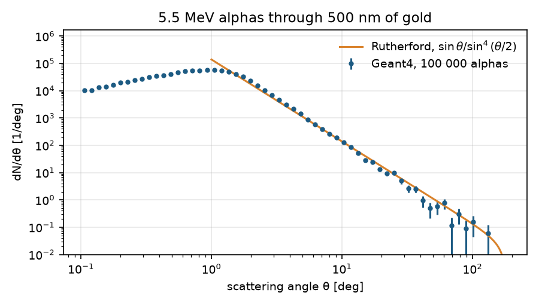
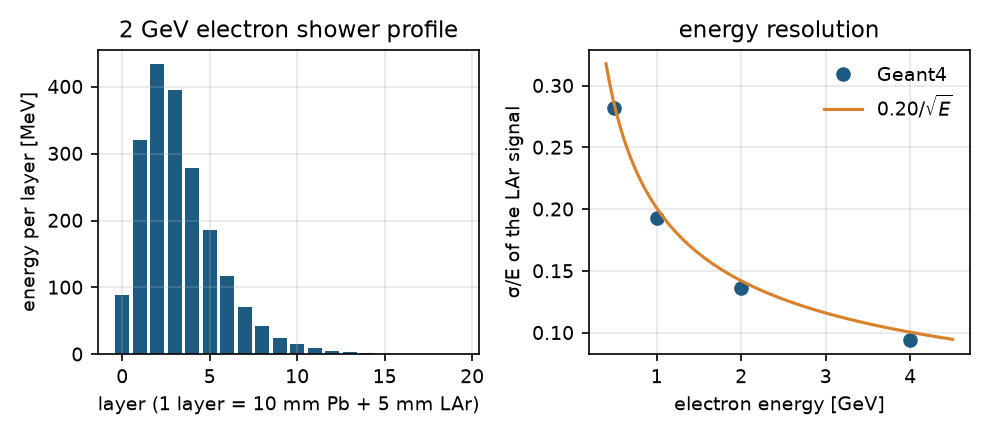
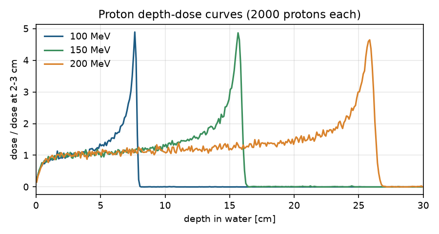
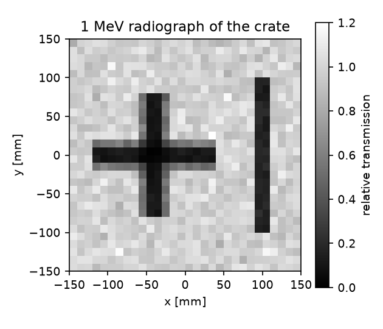

# Geant4 with Python: a beginner's developer guide

This guide teaches the Geant4 concepts used by `geant4-python-application` and
shows how to build small simulations in Python. It is intentionally practical:
the Python package provides a high-level application, while the Geant4 kernel
does the particle transport in native C++.

It is not a complete replacement for the official Geant4 Application Developer
Guide. Use that guide for detailed physics, geometry, and toolkit reference. Use
this guide for the Python interface and this repository's supported workflow.

How the guide is organised:

- **Parts I–V** teach the concepts and how to write a simulation program, from
  a ten-event first run to a production campaign.
- **Part VI** explains how the package works inside: the worker process, the
  application lifecycle, and the event data model.
- **Part VII** has five complete detector simulations, each run and checked
  against reference physics: Rutherford's gold foil, a sampling calorimeter,
  a proton-therapy Bragg peak, a magnetic spectrometer, and gamma radiography.
- **Part VIII** catalogues the repository's examples, and **Part IX** is the
  API reference.
- **Part X** is for contributors to the package itself: building, testing, CI,
  Geant4 upgrades, the conda recipe, and releases.

## 1. The simulation idea

A Geant4 simulation normally has these pieces:

1. **Geometry**: the world, solids, logical volumes, materials, and placements.
2. **Physics**: the processes that act on particles.
3. **Primary generator**: the particles, energies, positions, and directions
   injected into the geometry.
4. **Run and event actions**: code that runs at run/event boundaries.
5. **Scoring**: the quantities extracted from steps, tracks, or volumes.

In this Python package, geometry is supplied as GDML, physics and generators are
configured through `Application`, and the built-in native actions record events,
tracks, and steps into an Awkward Array.

The normal lifecycle is:

```text
create Application -> configure -> initialize -> BeamOn/run -> analyze output
```

## 2. Installation

Prebuilt wheels bundle a compiled Geant4 11.4.3, so on supported platforms you
do **not** need to install Geant4 (C++) yourself:

| Platform               | Python     | Prebuilt wheel | Qt viewer (`[gui]`) |
| ---------------------- | ---------- | -------------- | ------------------- |
| macOS, Apple Silicon   | 3.8 – 3.13 | yes            | yes                 |
| macOS, Intel           | 3.8 – 3.13 | yes            | yes                 |
| Linux x86_64           | 3.8 – 3.13 | yes            | yes (needs OpenGL)  |
| Linux aarch64, Windows | —          | no             | build from source   |

On Windows, WSL works with the Linux wheels.

### 2.1 Create a fresh virtual environment first

Always install into a new environment. Mixing the package with whatever is
already in the system Python or conda's `base` environment (another Qt/PyQt,
numpy or Geant4 build) is the most common cause of library mismatch errors, and
recent Ubuntu/Debian refuse `pip install` outside an environment with
`externally-managed-environment`.

```bash
python3 -m venv g4-env
source g4-env/bin/activate
python -m pip install --upgrade pip
```

or with conda:

```bash
conda create -n g4 python=3.12 -y
conda activate g4
```

Activate the environment again in every new terminal.

### 2.2 Install from PyPI

```bash
pip install "geant4-python-application[gui]"
```

Leave out `[gui]` for a physics-only install without Qt (servers, containers,
clusters):

```bash
pip install geant4-python-application
```

Wheels are also attached to every GitHub release from 0.1.0 on, and each run of
the Wheels workflow keeps them as downloadable artifacts for 90 days; see
`INSTALLATION.md` for installing those with `--find-links`.

### 2.3 Check the installation

```bash
python - <<'PY'
import geant4_python_application as g4

print("package:", g4.__version__)
print("Geant4:", g4.geant4_version)
print("MT available:", g4.Application.multithreading_available())
print("viewer available:", g4.Application.visualization_available())
print("Physics lists:", g4.Application.available_physics_lists()[:5])
PY
```

### 2.4 Geant4 data files

The physics data files (~2 GB) are not part of the wheel. They are downloaded
the first time a simulation runs, once per user, into a directory shared by all
your environments:

- macOS: `~/Library/Application Support/geant4_python_application`
- Linux: `~/.local/share/geant4_python_application`

```bash
python -c "import geant4_python_application as g4; print(g4.data_directory())"
```

The download is robust: interrupted downloads resume, failed downloads raise an
error, and each archive's MD5 checksum is verified before it is extracted.
Datasets already downloaded for another Geant4 version are hard-linked (or
copied, across filesystems) instead of downloaded again when their name and
version have not changed.

If an installed Geant4 of exactly the same version (for example conda-forge's
`geant4=11.4.3`) already provides every dataset, those are used and nothing is
downloaded. The package reads the dataset environment variables that conda sets
on activation (`G4LEDATA`, `G4ENSDFSTATEDATA`, ...) and otherwise asks
`geant4-config --check-datasets`.

To store the data elsewhere, set `GEANT4_PYTHON_APPLICATION_DIR` before import,
or call `g4.application_directory(path)` before the application initializes;
`g4.application_directory(temp=True)` uses a temporary directory. For cluster
jobs, point it at a shared location so jobs do not each download the data.
Uninstalling the package does not remove the data; delete the directory
yourself.

### 2.5 Building from source

Platforms without wheels, and work on the package itself, need a Geant4 11.4.3
installation and a source build. Section 80 walks through it.

## 3. Your first simulation

Create `first_simulation.py`:

```python
import geant4_python_application as g4


def main():
    with g4.Application(gdml=g4.basic_gdml, seed=137) as app:
        events = app.run(10)

    print(events.fields)
    print("number of events:", len(events))
    print(events[:2])


if __name__ == "__main__":
    main()
```

**Always put the code that creates an `Application` under
`if __name__ == "__main__":` in a script.** Geant4 runs in a separate worker
process (section 60). On macOS, and on Linux from Python 3.14, Python starts
that process by re-importing your script; without the guard the re-import tries
to create another application and the script fails with a `RuntimeError` about
the "bootstrapping phase" followed by "Application process died". Jupyter
notebooks and the interactive interpreter do not need the guard. The shorter
snippets in this guide leave it out for readability; add it when you paste them
into a script.

`basic_gdml` is a small air world containing a water box. The context manager
starts and stops the worker process safely. `run(10)` transports ten events.

The result is an `awkward.Array`, which is useful because each event can have a
different number of tracks, steps, and primary particles.

## 4. Choosing the physics list

A physics list selects the electromagnetic, decay, hadronic, optical, and other
processes used during transport:

```python
import geant4_python_application as g4

print(g4.Application.available_physics_lists())

with g4.Application(gdml=g4.basic_gdml, physics="FTFP_BERT") as app:
    events = app.run(100)
```

`custom` is the package's built-in list. Reference lists such as `FTFP_BERT`
come from Geant4. Do not compare results from different lists as though they
were the same physical model.

Optional constructors can be added before initialization:

```python
with g4.Application(gdml=g4.basic_gdml, physics="FTFP_BERT") as app:
    app.add_physics("G4EmDNAPhysics_option2")
    events = app.run(100)
```

## 5. Primary particles

The convenient generator API configures a particle gun or GPS source:

```python
with g4.Application(gdml=g4.basic_gdml) as app:
    app.generator.use_gps().particle("gamma").energy(2, "MeV")
    app.generator.position(0, 0, -10, "cm").direction(0, 0, 1)
    events = app.run(1000)
```

The command interface exposes ordinary Geant4 UI commands:

```python
with g4.Application(gdml=g4.basic_gdml) as app:
    app.commands(
        [
            "/gun/particle e-",
            "/gun/energy 10 MeV",
            "/gun/position 0 0 -10 cm",
            "/gun/direction 0 0 1",
        ]
    )
    events = app.run(100)
```

For advanced GPS distributions, use `/gps/...` commands through
`app.generator.commands(...)`.

## 6. Geometry with GDML

This package does not expose arbitrary Python subclasses of
`G4VUserDetectorConstruction`. Instead, provide a GDML string or file. A minimal
GDML detector has:

- `<define>` constants
- `<materials>` or references to Geant4 NIST materials
- `<solids>`
- `<structure>` containing logical volumes and physical placements
- a `<setup>` that identifies the world volume

The built-in example uses NIST materials:

```xml
<materialref ref="G4_WATER"/>
```

Run your own GDML file like this:

```python
from pathlib import Path
import geant4_python_application as g4

gdml = Path("detector.gdml").read_text()

with g4.Application(gdml=gdml) as app:
    events = app.run(100)
    print(app.detector.logical_volumes)
    print(app.detector.physical_volumes)
```

Inspect geometry before running. The GDML is parsed when the application
initializes, so call `initialize()` first; before that the volume and material
sets are empty and `check_overlaps()` raises an error:

```python
with g4.Application(gdml=gdml) as app:
    app.initialize()
    print(app.detector.materials)
    print(app.detector.logical_volumes)
    print(app.detector.physical_volumes)
    if app.detector.check_overlaps():  # True means an overlap was found
        raise RuntimeError("the geometry has overlapping volumes")
```

Two kinds of names are used, so inspect them rather than guessing:

- **physical volume names** (`<physvol name="...">`) appear in the event data
  as `step.volume` and are what `Scoring.energy_deposit(events, volume=...)`
  filters on;
- **logical volume names** (`<volume name="...">`) are what
  `detector.sensitive_volumes` takes.

For `g4.basic_gdml` the water box is the physical volume `box`, placed from the
logical volume `boxVolume`.

## 7. Fields and sensitive volumes

Uniform global fields can be assigned before the run:

```python
with g4.Application(gdml=gdml) as app:
    app.detector.magnetic_field = (0.0, 0.0, 1.5)  # tesla
    app.detector.electric_field = (0.0, 0.0, 0.5)  # kV/cm
    events = app.run(100)
```

Fields, like sensitive volumes, must be set before the application initializes
(before the first `run`).

To mark a detector volume as sensitive, give its **logical** volume name, before
initialization:

```python
with g4.Application(gdml=gdml) as app:
    app.detector.sensitive_volumes = {"gasVolume"}
    events = app.run(100)
```

This does not create a custom Python `ProcessHits` implementation. The package
records native Geant4 steps and provides Python-side filtering and scoring.

## 8. Understanding the event output

Common fields include event IDs, primary information, tracks, and steps:

```python
print(events.fields)
print(events.id)
print(events.track.fields)
print(events.track.step.fields)
```

Because this is a jagged structure, use Awkward operations rather than assuming
every event has the same number of tracks:

```python
import awkward as ak

track_counts = ak.num(events.track.id, axis=1)
print(track_counts)
```

Two step fields have special values worth knowing:

- `step_process` and `step_process_type` are `"InitStep"` for the first step of
  a track, where no process has acted yet. Otherwise `step_process` is the
  process name (for example `"eIoni"`) and `step_process_type` its category (for
  example `"Electromagnetic"`).
- `step_volume` is `"OutOfWorld"` when a step starts without a volume, which
  Geant4 11.4 can produce for a primary generated exactly on the world boundary.

The default event fields can be reduced for smaller output with:

```python
with g4.Application(gdml=g4.basic_gdml) as app:
    app.set_event_fields({"run", "id", "track_id", "step_energy", "step_volume"})
    events = app.run(100)
```

## 9. Scoring energy deposition

Post-run scoring is often the easiest way to start:

```python
import awkward as ak
import geant4_python_application as g4

with g4.Application(gdml=g4.basic_gdml) as app:
    app.command("/gun/particle e-")
    app.command("/gun/energy 10 MeV")
    events = app.run(100)

edep = g4.Scoring.energy_deposit(events)
print("energy per event in keV:", ak.to_numpy(edep))

edep_box = g4.Scoring.energy_deposit(events, volume="box")
mesh, edges = g4.Scoring.energy_mesh(events, bins=(20, 20, 20))
```

For native Geant4 scoring meshes:

```python
with g4.Application(gdml=g4.basic_gdml) as app:
    mesh = g4.NativeScoringMesh(app, name="dose")
    mesh.box(half_size=(250, 250, 250), bins=(20, 20, 20), unit="mm")
    app.run(1000)
    mesh.dump("dose.out")
```

## 10. Saving results

```python
from pathlib import Path
from geant4_python_application import io

io.events_to_parquet(events, Path("events.parquet"))
```

ROOT output is available when `uproot` is installed:

```python
io.events_to_root(events, "events.root")
```

## 11. Visualization

Install with the `gui` extra:

```bash
pip install "geant4-python-application[gui]"
```

The extra installs Qt from the `PyQt5-Qt5` package, so no Homebrew, conda or
system Qt is needed. The viewer is a separate module that only
`Application.visualize()` loads: importing the package and running simulations
never loads Qt, so headless machines need neither Qt nor OpenGL.

```python
with g4.Application(gdml=g4.basic_gdml) as app:
    app.command("/gun/particle gamma")
    app.command("/gun/energy 1 MeV")
    app.visualize()
```

The call returns when the window is closed; commands such as `/run/beamOn 10`
can be typed into the viewer's command panel.

To check whether a viewer can be opened, without loading Qt:

```python
print(g4.Application.visualization_available())
```

If it cannot, `app.visualize()` raises a `RuntimeError` explaining what is
missing. On Linux, Qt still uses the system's OpenGL and X11 libraries; desktop
installations have them, minimal ones may need packages such as `libgl1` and
`libxkbcommon-x11-0` (`INSTALLATION.md` lists them).

Source builds leave the viewer out by default. It needs a Geant4 built as shared
libraries with Qt and OpenGL, and is enabled with:

```bash
pip install . -Ccmake.define.GEANT4_PYTHON_APPLICATION_VISUALIZATION=ON
```

Visualization is for inspecting geometry and tracks; production runs should be
performed in batch mode without the viewer. Scripts that open the viewer by
default, such as the example ports (section 72), accept `--batch` to run
headless.

## 12. Multithreading and MPI

Use native Geant4 CPU multithreading when the linked Geant4 was built with
multithreading:

```python
with g4.Application(gdml=g4.basic_gdml, n_threads=8) as app:
    events = app.run(100000)
```

Check availability with:

```python
print(g4.Application.multithreading_available())
```

For MPI, launch multiple Python processes and split the event count by rank:

```python
from geant4_python_application import distributed as dist

rank, size = dist.get_rank_size()
_, count = dist.split_count(100000, rank, size)

with g4.Application(gdml=g4.basic_gdml, seed=1000 + rank) as app:
    events = app.run(count)
    g4.io.events_to_parquet(events, f"events_rank_{rank}.parquet")
```

Run it with:

```bash
mpiexec -n 4 python mpi_run.py
```

MPI splitting and file merging are intentionally left to the application. Use
unique seeds and unique output files for each rank.

## 13. Reproducibility and validation

Set a seed for repeatable runs:

```python
with g4.Application(gdml=g4.basic_gdml, seed=1234) as app:
    events = app.run(1000)
```

The same seed, configuration, and Geant4 version give the same events. Results
change with the Geant4 version (moving from 11.2 to 11.4 changed the exact step
energies of seeded runs), physics list, thread count, platform, and
random-engine behavior. So do not hard-code event-by-event values from one
version into a test; check reproducibility instead:

```python
import awkward as ak
import numpy as np


def step_energies(seed):
    with g4.Application(gdml=g4.basic_gdml, seed=seed) as app:
        events = app.run(100)
    return np.asarray(ak.flatten(events.track.step.energy, axis=None))


assert np.array_equal(step_energies(1100), step_energies(1100))
```

Validate a simulation by checking geometry overlaps, inspecting particle/energy
distributions, and running enough events for the statistical uncertainty to be
meaningful.

## 14. What this interface does not currently expose

The current package is a high-level Python application rather than a complete
Python binding for every Geant4 class. It does not currently provide arbitrary
Python subclasses of detector construction, sensitive detectors, physics
processes, fields, or action classes. It also does not provide CUDA/GPU
transport. For those use cases, use native C++ Geant4 or a lower-level binding
such as `geant4_pybind`.

## 15. A recommended learning path

Work through these stages in order:

1. Run `basic_gdml` with ten events.
2. Change the particle, energy, position, and direction.
3. Inspect `events.fields`, tracks, and steps.
4. Score energy deposition in a named volume.
5. Edit or generate a GDML detector.
6. Add fields and optical physics.
7. Save results to Parquet and analyze them with NumPy/Awkward.
8. Increase event counts and enable Geant4 multithreading.
9. Use MPI splitting for independent distributed jobs.

The repository's numbered examples in `examples/geant4-examples/` correspond to
these topics and are useful as runnable companion exercises.

# Part II - Building a complete application

## 16. The application state machine

The Python `Application` is a thin controller around a native Geant4
application. It starts a child process, sends configuration calls to the native
application, and returns data to the parent Python process. This design keeps
the Geant4 kernel isolated and means that configuration must happen in the order
expected by Geant4.

The useful states are:

| State       | What you can do                                                               |
| ----------- | ----------------------------------------------------------------------------- |
| Created     | Set Python constructor options such as GDML, physics, seed, and thread count. |
| Started     | Configure the manager, physics, detector, and generator.                      |
| Initialized | Inspect the initialized detector and run events.                              |
| Running     | Geant4 transports events and records native actions.                          |
| Finished    | Analyze or persist the returned Awkward Array in Python.                      |

Most configuration must occur before the first call to `run`. For example,
physics constructors cannot be added after initialization:

```python
with g4.Application(gdml=g4.basic_gdml, physics="FTFP_BERT") as app:
    app.add_physics("G4EmExtraPhysics")
    app.detector.sensitive_volumes = {"boxVolume"}
    app.initialize()
    events = app.run(100)
```

Calling `run` automatically initializes a correctly configured application, so
explicit `initialize()` is optional unless you want to validate setup first.

## 17. A complete reproducible example

The following example is a good template for new projects:

```python
from pathlib import Path

import awkward as ak
import geant4_python_application as g4


def main():
    output = Path("events.parquet")

    with g4.Application(
        gdml=g4.basic_gdml,
        physics="FTFP_BERT",
        seed=2025,
        n_threads=4,
    ) as app:
        app.set_event_fields(
            {
                "run",
                "id",
                "track_id",
                "track_particle",
                "step_energy",
                "step_volume",
                "step_position",
            }
        )
        app.detector.sensitive_volumes = {"boxVolume"}
        # with n_threads > 0, initialize before configuring the source and use
        # /gun/ commands: app.generator needs the serial run manager (section 28)
        app.initialize()
        app.commands(
            [
                "/gun/particle gamma",
                "/gun/energy 2 MeV",
                "/gun/position 0 0 -10 cm",
                "/gun/direction 0 0 1",
            ]
        )
        events = app.run(10_000)

    deposited = g4.Scoring.energy_deposit(events, volume="box")
    print("events:", len(events))
    print("mean deposited energy [keV]:", float(ak.mean(deposited)))
    g4.io.events_to_parquet(events, output)


if __name__ == "__main__":
    main()
```

Keep the simulation and analysis stages conceptually separate. The simulation
should produce a stable event record; analysis should be rerunnable without
transporting particles again.

## 18. Units, coordinates, and naming

Geant4 is unit-aware internally. In this interface, generator and field helper
methods take explicit unit strings, while GDML also declares units on numeric
values. Never silently mix millimetres, centimetres, metres, or tesla.

```python
app.generator.position(0, 0, -10, "cm")
app.generator.energy(5, "MeV")
app.detector.magnetic_field = (0, 0, 1.0)  # tesla
```

Positions in the event output and Python scoring mesh are expressed in
millimetres, and deposited energies are expressed in keV. Volume names are
case-sensitive strings originating in GDML.

A useful naming convention is:

```text
World                 world physical volume
detectorVolume        logical volume
detector              physical placement
```

Use unique, descriptive names. A name that is convenient in a GDML file is also
the name you will use later for filtering, scoring, and diagnostics.

## 19. Geometry design with GDML

### 19.1 The geometry hierarchy

The hierarchy is:

```text
solid -> logical volume -> physical volume -> world
```

A solid describes shape and dimensions. A logical volume combines a solid and a
material. A physical volume places a logical volume inside its mother. The world
is the top-level physical geometry used by the setup.

### 19.2 A small custom detector

Save this as `detector.gdml` and pass its text to the application:

```xml
<?xml version="1.0" encoding="UTF-8"?>
<gdml>
  <define>
    <constant name="worldHalf" value="500"/>
    <constant name="targetHalf" value="50"/>
  </define>
  <solids>
    <box name="worldSolid" x="worldHalf" y="worldHalf" z="worldHalf" lunit="mm"/>
    <box name="targetSolid" x="targetHalf" y="targetHalf" z="targetHalf" lunit="mm"/>
  </solids>
  <structure>
    <volume name="targetVolume">
      <materialref ref="G4_Si"/>
      <solidref ref="targetSolid"/>
    </volume>
    <volume name="worldVolume">
      <materialref ref="G4_AIR"/>
      <solidref ref="worldSolid"/>
      <physvol name="target">
        <volumeref ref="targetVolume"/>
        <position name="targetPosition" unit="mm" x="0" y="0" z="0"/>
      </physvol>
    </volume>
  </structure>
  <setup name="Default" version="1.0">
    <world ref="worldVolume"/>
  </setup>
</gdml>
```

Then validate and run:

```python
from pathlib import Path
import geant4_python_application as g4

gdml = Path("detector.gdml").read_text()
with g4.Application(gdml=gdml) as app:
    app.initialize()
    print(app.detector.materials)
    print(app.detector.physical_volumes)
    assert not app.detector.check_overlaps()
    events = app.run(100)
```

### 19.3 Overlaps and navigation errors

Overlapping daughter volumes can cause physically incorrect navigation. Check
overlaps after loading a detector and before large production runs. If a track
behaves unexpectedly, inspect the volume names, placement coordinates, mother
volume, and units first.

## 20. Materials and optical properties

The repository's GDML examples use Geant4 NIST material names such as `G4_AIR`,
`G4_WATER`, and `G4_Si`. This is the simplest way to begin. For a custom
material, define its density and composition in GDML according to the Geant4
GDML schema.

Optical transport needs both optical physics and optical material properties.
For example, a material that should transmit photons needs a refractive index
table. Merely setting `optical=True` does not invent optical properties:

```python
from geant4_python_application import optical as gopt

with g4.Application(gdml=gopt.optical_water_gdml, optical=True) as app:
    app.commands(gopt.scintillation_commands(yield_factor=1.0))
    events = app.run(1_000)
```

Inspect the output particle field to distinguish optical photons from the
primary particle and other secondaries.

## 21. Particle sources in detail

### 21.1 Particle-gun workflow

Use a particle gun when every event has a simple, controlled primary:

```python
with g4.Application(gdml=g4.basic_gdml) as app:
    app.generator.particle("proton")
    app.generator.energy(100, "MeV")
    app.generator.position(0, 0, -20, "cm")
    app.generator.direction(0, 0, 1)
    events = app.run(100)
```

The primary position must be inside the world volume. A vertex outside it makes
`run` raise a `RuntimeError` naming the position and the world volume, where
plain Geant4 11.4 would crash the process (or, after initialization, silently
keep the previous gun position). The application survives the error, so correct
the position and run again:

```python
with g4.Application(gdml=g4.basic_gdml) as app:  # the world spans +-50 cm
    app.command("/gun/position 0 0 1 m")
    try:
        app.run(1)
    except RuntimeError as error:
        print(
            error
        )  # Primary vertex at (0.000000, 0.000000, 100.000000) cm is outside ...
    app.command("/gun/position 0 0 0 cm")
    events = app.run(2)
```

The check applies to the particle gun and to event-by-event primary arrays
(section 21.3).

### 21.2 General Particle Source

Use GPS commands for distributions in position, angle, or energy:

```python
with g4.Application(gdml=g4.basic_gdml) as app:
    app.generator.use_gps()
    app.generator.commands(
        [
            "/gps/particle gamma",
            "/gps/ene/type Mono",
            "/gps/ene/mono 1 MeV",
            "/gps/pos/type Point",
            "/gps/pos/centre 0 0 -10 cm",
            "/gps/direction 0 0 1",
        ]
    )
    events = app.run(100)
```

### 21.3 Event-by-event primary arrays

For a predefined beam, provide an Awkward Array containing primary fields. This
is useful when the source comes from a file or another simulation:

```python
import awkward as ak

primaries = ak.Array(
    {
        "particle": ["gamma", "gamma", "e-"],
        "energy": [1000.0, 2000.0, 5000.0],  # keV
        "position": {"x": [0, 0, 0], "y": [0, 0, 0], "z": [-10, -10, -10]},  # cm
        "direction": {"x": [0, 0, 0], "y": [0, 0, 0], "z": [1, 1, 1]},
    }
)

with g4.Application(gdml=g4.basic_gdml) as app:
    events = app.run(primaries)
```

Energies are in keV and positions in cm here (section 73.1). Add a
`primaries` field holding a list per event to put several primaries in one
event. Test array-driven primaries in serial mode first. The repository currently
documents limitations for this input path in multithreaded runs.

## 22. Physics choices and statistical thinking

A simulation result is determined by geometry, materials, source, physics list,
production cuts, random seed, and event count. Changing any of these changes the
result or its interpretation.

Use a small run for functional validation, then a larger run for physics:

```python
for n_events in (1, 10, 1_000, 100_000):
    with g4.Application(gdml=g4.basic_gdml, seed=100 + n_events) as app:
        events = app.run(n_events)
    print(n_events, len(events))
```

Do not interpret a single Monte Carlo event as a measurement. Report the sample
size and an uncertainty or confidence interval for the quantity of interest.

## 23. Tracking, steps, and secondaries

An event contains primary vertices and can contain many tracks. A track is
advanced through a sequence of steps. A step can end because of geometry, a
physics interaction, a field integration limit, or another tracking condition.

Useful questions to ask in analysis are:

```python
print(events.track.particle)
print(events.track.creator_process)
print(events.track.step.volume)
print(events.track.step.process)
```

For example, select positive-energy steps and inspect their volumes:

```python
hits = events.hits()
detector_hits = hits[hits.volume == "box"]
```

The exact Awkward slicing expression can depend on the nesting shape, so begin
with `events.fields`, `events.track.fields`, and `events.track.step.fields`.

## 24. Actions and callbacks in this package

Native C++ actions are installed by the package and record run, event, track,
and step data. Python callbacks are an offline analysis layer:

```python
def on_event(event):
    print("event", event.id)


with g4.Application(gdml=g4.basic_gdml) as app:
    events = app.run_with_callbacks(10, on_event=on_event)
```

Callbacks do not replace native Geant4 `G4UserRunAction`, `G4UserEventAction`,
or `G4VSensitiveDetector` subclasses. They execute after transport over the
returned records. This makes them convenient for Python analysis, but not
suitable for changing transport behavior during a step.

## 25. Control commands and diagnostics

Any command accepted by the configured Geant4 application can be sent through
`app.command` or `app.commands`:

```python
with g4.Application(gdml=g4.basic_gdml) as app:
    print(app.list_commands("/run"))
    app.command("/run/verbose 1")
    events = app.run(1)
```

Use verbose output sparingly. Large verbose logs can dominate runtime and make
it harder to see the actual error. Prefer small event counts while debugging.

## 26. Visualization as a debugging tool

The Qt viewer is most useful for answering geometry questions: is the world
present, is the target where expected, and does the primary start in the world?
Install the `[gui]` extra (or build from source with visualization enabled),
then run a few events. Keep visualization separate from production output and do
not use it to estimate physics results.

## 27. Production run design

For a production campaign:

1. Freeze the GDML, physics list, package version, and Geant4 version.
2. Validate the geometry and source with a one-event visualization run.
3. Run a small serial reference sample.
4. Compare a multithreaded sample with the same configuration.
5. Split large jobs into deterministic MPI ranks with unique seeds.
6. Write one output file per rank.
7. Merge and analyze outside the transport process.

Do not write all ranks to the same file unless the output format and writer are
explicitly designed for concurrent access.

# Part III - Advanced topics and boundaries

## 28. Multithreading in detail

`n_threads=0` selects the serial Geant4 run manager. A positive value selects
the multithreaded run manager and requests that many worker threads:

```python
with g4.Application(gdml=g4.basic_gdml, n_threads=8) as app:
    events = app.run(100_000)
```

The linked Geant4 library must have been compiled with multithreading.

**Configure the source differently in multithreaded mode.** Geant4 gives each
worker thread its own primary generator and none to the master thread, which is
where the package's commands arrive. Two consequences:

- `app.generator.*` raises `RuntimeError: Primary generator action is not
  available` when `n_threads > 0`; use `/gun/...` or `/gps/...` commands
  instead.
- Those commands exist only once the workers are built, so call
  `app.initialize()` first; before it they fail with code 100.

```python
with g4.Application(gdml=g4.basic_gdml, n_threads=8, seed=1) as app:
    app.initialize()
    app.commands(["/gun/particle proton", "/gun/energy 50 MeV"])
    events = app.run(100_000)
```

Settings that must precede initialization (sensitive volumes, fields, extra
physics, production cuts) go before `initialize()`. More threads are not always
faster: geometry initialization, memory pressure, output
construction, and CPU oversubscription can reduce the gain.

Benchmark with the same event count and seed policy. Validate event counts and
aggregate quantities, but do not require event ordering to be identical across
thread counts.

## 29. MPI and hybrid execution

MPI creates independent Python/Geant4 processes. Each rank should construct its
own application and run only its assigned events. A common hybrid strategy is
one MPI rank per node with several Geant4 worker threads per rank:

```python
rank, size = dist.get_rank_size()
_, count = dist.split_count(1_000_000, rank, size)

with g4.Application(
    gdml=g4.basic_gdml,
    n_threads=8,
    seed=10_000 + rank,
) as app:
    events = app.run(count)
    g4.io.events_to_parquet(events, f"events_{rank:04d}.parquet")
```

This package provides rank discovery and event splitting, not an automatic
Geant4 MPI manager, collective reduction, or file merger.

## 30. Performance and memory

Recording every step for every track can produce large nested arrays. For large
runs:

- request only the event fields needed for analysis;
- run in batches and write one file per batch;
- avoid Python callbacks for every step unless necessary;
- use native scoring meshes when a full step record is not needed;
- benchmark thread counts on the target machine.

The `Application` worker process also means that event data is transferred back
to the parent Python process. Treat that transfer as part of the cost of a
high-volume run.

## 31. Testing a simulation

A useful test suite has three layers:

### Configuration tests

Check that the GDML loads, expected volumes exist, overlaps are absent, and the
selected physics list is available.

### Transport smoke tests

Run one to ten events and assert that the result contains the expected fields
and event count.

### Physics regression tests

Run a fixed seed and compare distributions or aggregate values with tolerances.
Avoid exact event-by-event comparisons when changing thread count, platform, or
Geant4 version; to test seeding, compare two runs with the same seed instead
(section 13).

```python
def test_smoke():
    with g4.Application(gdml=g4.basic_gdml, seed=7) as app:
        events = app.run(5)
    assert len(events) == 5
    assert "id" in events.fields
```

## 32. Common failure modes

**Import fails with a library or symbol error.** The package is mixing with
libraries already in the environment (another Qt/PyQt, numpy or Geant4). Create
a fresh virtual environment and install there (section 2.1).

**`pip install` refuses with `externally-managed-environment`.** The system
Python is protected; install into a virtual environment.

**The data files are missing, or a download fails.** Run again: interrupted
downloads resume. Check that `g4.data_directory()` is writable and has ~2 GB
free. When relying on an installed Geant4's data, its version must equal
`g4.geant4_version` and every dataset must be present, otherwise the package
downloads its own copy.

**A script fails with "current process has finished its bootstrapping phase"
or "Application process died".** The script creates the `Application` at module
level. Move that code into a function called under `if __name__ == "__main__":`
(section 3).

**`Primary generator action is not available`, or a `/gun/` command fails with
code 100.** The application is multithreaded. Call `app.initialize()` first and
configure the source with `/gun/` or `/gps/` commands instead of
`app.generator` (section 28).

**`Could not find logical volume '...'`.** `detector.sensitive_volumes` takes
logical volume names (`<volume name>`), not physical ones (`<physvol name>`).

**`Detector is not constructed`.** `check_overlaps()` and the volume lists need
an initialized application; call `app.initialize()` first.

**`RuntimeError: Primary vertex ... is outside the world volume`.** The gun or
primary-array position lies outside the world. Check the units (`cm` versus `m`)
and the world's half-lengths (section 21.1).

**`app.visualize()` raises a `RuntimeError`.** Install the `[gui]` extra and, on
Linux, the OpenGL/X11 libraries; `g4.Application.visualization_available()`
reports whether the viewer can open. On a machine without a display, run
headless with `--batch`.

**`n_threads` fails.** Check `g4.Application.multithreading_available()` and use
`n_threads=0` with a serial Geant4 build.

**A volume cannot be found.** Print `app.detector.logical_volumes` and
`app.detector.physical_volumes`; GDML names are case-sensitive.

**Energy deposition is empty.** Confirm that step fields were requested, that
the particle enters the volume, and that the volume filter uses the actual
physical volume name.

**The detector overlaps.** Check half-length versus full-length conventions,
mother volume dimensions, placement coordinates, and units.

**The run is unexpectedly slow.** Reduce fields, disable verbose output, use a
smaller diagnostic run, and benchmark thread counts. Optical photon tracking can
be substantially more expensive than the primary transport.

## 33. Mapping native Geant4 concepts to this Python interface

| Native Geant4 concept                            | Python-interface equivalent                             |
| ------------------------------------------------ | ------------------------------------------------------- |
| `G4RunManager`                                   | `Application` and its native manager setup              |
| `G4VUserDetectorConstruction`                    | GDML supplied to `Application`                          |
| `G4VUserPhysicsList`                             | `physics="..."` and curated `add_physics(...)`          |
| `G4VUserPrimaryGeneratorAction`                  | `app.generator` or `/gun` and `/gps` commands           |
| `G4RunManager::BeamOn`                           | `app.run(n_events)`                                     |
| `G4UserRunAction` / event / track / step actions | Built-in native recording plus offline Python callbacks |
| Sensitive detector / hits                        | Recorded steps, `events.hits()`, and Python scoring     |
| Command-based scoring                            | `NativeScoringMesh`                                     |
| Geant4 visualization manager                     | `app.visualize()` with the `[gui]` extra                |
| Geant4 MT run manager                            | `n_threads=N`                                           |
| MPI job splitting                                | `distributed.get_rank_size()` and `split_count()`       |

## 34. Scope boundary

This guide is deliberately detailed about the supported interface, but the
interface is not a one-to-one Python binding of the entire Geant4 class library.
If your project requires custom C++ user actions, arbitrary physics processes,
custom field equations, native digitizers, parallel worlds, advanced biasing, or
CUDA transport, you will need native Geant4 C++ or a lower-level binding.

That boundary is useful: use this package when a GDML detector, configured
physics list, standard generator, native transport, and Python analysis are a
good fit. Move to native C++ when transport-time customization is central to the
experiment.

## 35. Suggested projects

After completing the examples, build these projects in order:

1. A monoenergetic gamma beam through the water box, measuring deposited energy.
2. A silicon target with an electron beam and a magnetic field.
3. An optical scintillator with a refractive-index table and optical-photon
   count.
4. A GDML detector imported from a CAD/STL workflow.
5. A multithreaded dose map with Parquet output.
6. An MPI campaign that writes one result file per rank and performs a separate
   merge and uncertainty analysis.

For each project, write down the geometry, material, source, physics list,
field, scoring definition, event count, seed policy, and validation checks.

# Part IV - A thesis-style learning curriculum

## 36. How to read this book

This book is organized as a progression rather than a catalogue of APIs. Read
the first five chapters in order. After that, choose a project and return to the
relevant chapters while implementing it. Every serious simulation should be
understandable in four layers:

1. **Physical question** - what quantity are you trying to estimate?
2. **Monte Carlo model** - what particles, materials, processes, and geometry
   represent that question?
3. **Software implementation** - which GDML, Python configuration, and scoring
   code implement the model?
4. **Evidence** - what checks show that the result is correct and precise?

Do not begin by copying a large detector. Begin with a small experiment for
which you can predict the direction of the answer. A simulation becomes useful
when it is falsifiable: you should know what result would convince you that the
geometry, physics, or source is wrong.

## 37. Monte Carlo foundations

Geant4 transports individual particles through matter. A run with `N` primary
events is a random sample from a physical model. If `X_i` is the scored value
from event `i`, the sample mean is:

```text
mean(X) = (X_1 + X_2 + ... + X_N) / N
```

For independent events, the standard error of the mean decreases approximately
as `1 / sqrt(N)`. Doubling the precision therefore requires roughly four times
as many events. This is why a visually impressive one-event display is not a
measurement.

For a quantity with sample variance `s^2`, estimate the standard error as:

```text
standard_error = s / sqrt(N)
```

In Python:

```python
import numpy as np

values = ak.to_numpy(g4.Scoring.energy_deposit(events))
mean = values.mean()
error = values.std(ddof=1) / np.sqrt(len(values))
print(f"{mean:.4g} +/- {error:.3g} keV")
```

This statistical error does not include systematic uncertainty from geometry,
material data, physics-list choice, calibration, or an incorrect source model.

## 38. The first laboratory: a beam and a target

### Objective

Build a controlled experiment in which a monoenergetic electron crosses a water
target. Record the steps and estimate deposited energy per event.

### Procedure

```python
from pathlib import Path

import awkward as ak
import numpy as np
import geant4_python_application as g4


def run_experiment(n_events=1000):
    with g4.Application(gdml=g4.basic_gdml, seed=42) as app:
        app.set_event_fields(
            {
                "run",
                "id",
                "track_particle",
                "track_id",
                "step_energy",
                "step_volume",
                "step_position",
            }
        )
        app.commands(
            [
                "/gun/particle e-",
                "/gun/energy 1 MeV",
                "/gun/position 0 0 -300 mm",
                "/gun/direction 0 0 1",
            ]
        )
        return app.run(n_events)


events = run_experiment()
edep = ak.to_numpy(g4.Scoring.energy_deposit(events, volume="box"))
print("N =", len(edep))
print("mean [keV] =", np.mean(edep))
print("standard deviation [keV] =", np.std(edep, ddof=1))
```

### Interpretation

The result is not just a number. Record the particle, energy, target material,
target dimensions, physics list, seed, event count, and volume name alongside
it. A result without configuration metadata cannot be reproduced.

### Exercises

1. Change the electron energy from 1 MeV to 10 MeV.
2. Replace the electron with a gamma ray and explain the changed distribution.
3. Move the source outside the world (for example `/gun/position 0 0 -60 cm`,
   since the world spans +-50 cm) and read the `RuntimeError` that `run` raises.
   Then move it back and check that the same application runs again.
4. Set the target volume as sensitive and compare the resulting step records.

## 39. Designing a detector model

### 39.1 Start with the question

If the question is “how much energy reaches the sensor?”, the geometry needs a
sensor volume and a scoring definition. If the question is “what is the track
length in gas?”, the geometry needs the gas volume and the analysis must sum
step lengths or use an appropriate recorded field. Geometry should be driven by
the observable, not by visual complexity.

### 39.2 World volume

The world must contain every possible particle position and secondary track.
Make it large enough that particles do not begin outside it, but do not make it
unnecessarily enormous when using detailed navigation. Use a simple material
such as air or vacuum unless the physical question requires something else.

### 39.3 Detector volume

Give each important detector component a unique physical name. Put the material
on the logical volume and the position on the physical placement. This lets you
reuse a logical volume and place it several times while retaining distinct
physical names for analysis.

### 39.4 Geometry validation checklist

Before physics validation, check:

- world dimensions contain the source and expected secondaries;
- all solids have the intended full lengths and half lengths;
- daughter placements are inside their mothers;
- rotations use the intended convention;
- material names resolve;
- repeated placements have unique analysis names;
- overlap checks pass;
- a one-event visualization looks correct.

## 40. Materials as physical models

Material density affects stopping power and interaction probability. Elemental
composition affects cross sections and secondary production. Optical properties
affect refraction, reflection, absorption, and photon yield. A material name is
therefore not merely a label.

For each custom material, document:

- density and temperature;
- elemental or component composition;
- state and pressure where relevant;
- optical property tables and their energy/wavelength domain;
- the source of the values;
- the version of the data used.

Do not extrapolate optical tables silently beyond their defined domain. If a
simulation depends on a material parameter, include a validation plot or a small
numerical check in the project repository.

## 41. Selecting a physics list responsibly

A reference physics list is a coherent collection of models and processes. It is
usually safer than assembling individual processes without understanding their
interactions. Select a list based on particle types, energy range, target
materials, and required precision.

Use this decision process:

1. Identify all primary and likely secondary particle species.
2. Identify the lowest and highest relevant energies.
3. Identify whether electromagnetic, hadronic, decay, optical, or DNA physics is
   required.
4. Choose a documented reference list that covers the domain.
5. Run a small sensitivity comparison against another plausible list.
6. Record the choice and rationale.

Adding a constructor such as `G4EmDNAPhysics_option2` is an expert operation.
Confirm that the geometry, energy range, chemistry assumptions, and output
interpretation are appropriate before using it for a scientific conclusion.

## 42. Source modelling and phase space

The primary source is often the largest systematic uncertainty. Specify:

- particle species and charge;
- energy distribution;
- position distribution;
- direction and angular distribution;
- event time if relevant;
- correlations among primaries;
- normalization and exposure.

A source file may contain correlated variables. Preserve those correlations when
turning it into an Awkward Array. Do not independently shuffle energy and
direction unless the physical source is truly uncorrelated.

For multiple primaries per event, preserve the event boundaries. One event with
ten correlated primary vertices is not equivalent to ten independent events.

## 43. Data model and analysis architecture

The event output has a nested structure because physics is nested:

```text
run
  event
    primary vertices
    tracks
      steps
```

Use the event as the unit of statistical analysis. If you flatten all steps and
compute a mean without event weights, events with many steps receive more
influence than events with few steps. Decide whether you need an event-level,
track-level, or step-level observable before flattening.

### Event-level example

```python
edep_per_event = g4.Scoring.energy_deposit(events)
mean_edep = ak.mean(edep_per_event)
```

### Step-level example

```python
hits = events.hits(volume="box")
positive_steps = ak.flatten(hits.energy, axis=None)
```

These answer different questions. State the choice in the analysis document.

## 44. Scoring design patterns

### 44.1 Recorded-step scoring

Use recorded steps when you need positions, processes, track IDs, or custom
Python analysis. This is flexible but can consume substantial memory.

### 44.2 Native mesh scoring

Use `NativeScoringMesh` when you need a spatial energy-deposition map and do not
need every track and step in Python. This delegates scoring to native Geant4.

### 44.3 Hybrid scoring

Use a small diagnostic run with full steps, then a large production run with
minimal fields or a native mesh. This gives both interpretability and scale.

### 44.4 Efficiency and normalization

If you simulate only a biased or filtered sample, the result needs the correct
weighting. The present high-level package does not expose every Geant4 biasing
class, so treat event filtering as an analysis selection, not as an unbiased
estimate of the original flux.

## 45. Validation as a scientific workflow

Validation has three distinct meanings:

1. **Software validation**: does the program run and produce structurally valid
   output?
2. **Physics verification**: does the implementation reproduce a known result or
   limiting case?
3. **Experimental validation**: does the simulation agree with measured data
   within the combined uncertainty?

For every new detector, create a validation table:

| Test                | Expected behavior              | Result | Status    |
| ------------------- | ------------------------------ | ------ | --------- |
| Geometry load       | All named volumes exist        | ...    | pass/fail |
| Overlap check       | No overlaps in target region   | ...    | pass/fail |
| Empty field         | Straight neutral-particle path | ...    | pass/fail |
| Energy conservation | Balance within tolerance       | ...    | pass/fail |
| Physics comparison  | Agreement with reference       | ...    | pass/fail |
| Thread comparison   | Aggregate agreement            | ...    | pass/fail |

Keep failed tests visible. A simulation project becomes trustworthy when its
failures are discoverable rather than hidden.

## 46. Uncertainty studies

Vary one assumption at a time and compare the resulting distributions:

- physics list;
- material density or composition;
- detector dimensions;
- source energy or angular spread;
- field strength;
- production settings;
- event count;
- thread count and rank count.

Use independent seeds for independent systematic scenarios. Use a common-random-
number strategy only when you understand the covariance benefit and can explain
it in the analysis.

## 47. A capstone project: a small dose study

### Research question

Estimate the energy deposited in a water target by a monoenergetic gamma beam,
compare two photon energies, and report a statistical uncertainty.

### Project structure

```text
dose-study/
  detector.gdml
  run.py
  analyze.py
  results/
  README.md
```

### Run script

```python
from pathlib import Path
import geant4_python_application as g4


def run_energy(energy_mev, n_events, seed):
    gdml = Path("detector.gdml").read_text()
    with g4.Application(gdml=gdml, physics="FTFP_BERT", seed=seed) as app:
        app.set_event_fields({"id", "step_energy", "step_volume"})
        app.commands(
            [
                "/gun/particle gamma",
                f"/gun/energy {energy_mev} MeV",
                "/gun/position 0 0 -300 mm",
                "/gun/direction 0 0 1",
            ]
        )
        events = app.run(n_events)
    g4.io.events_to_parquet(events, f"results/events_{energy_mev}MeV.parquet")
    return g4.Scoring.energy_deposit(events, volume="target")


if __name__ == "__main__":
    for energy in (1, 5):
        run_energy(energy, n_events=100_000, seed=1000 + energy)
```

### Analysis questions

1. Does the mean deposited energy increase monotonically with beam energy?
2. How does the fraction of zero-deposition events change?
3. Is the difference larger than the combined statistical uncertainty?
4. Does changing from serial to four threads change the aggregate result?
5. What detector or source assumptions dominate the difference?

The capstone is complete only when the answer includes configuration metadata,
plots or tables, uncertainties, and a statement of limitations.

## 48. From Python to native Geant4

Eventually you may need a feature outside this package's binding boundary. The
conceptual translation remains useful:

- Python GDML configuration corresponds to native detector construction.
- `app.run` corresponds to `BeamOn`.
- Python scoring corresponds to native run/event/step actions or scorers.
- Offline callbacks correspond to analysis after an event record exists.
- A reference physics-list name corresponds to native physics-list factory use.

When moving to C++, first reproduce the Python result with the same geometry,
source, physics list, seed policy, and event count. Then introduce the native
customization one feature at a time. This makes it possible to distinguish a
binding difference from a physics-model difference.

## 49. Final competence checklist

A reader is ready to use this package independently when they can:

- explain the run, event, track, and step hierarchy;
- create and validate a GDML detector;
- choose and justify a physics list;
- define a reproducible source;
- configure fields and optical transport where supported;
- choose an event-level or step-level observable;
- produce an uncertainty estimate;
- save and reload results;
- compare serial, multithreaded, and MPI runs;
- diagnose geometry, data, and source failures;
- state which features require native Geant4;
- document a simulation so another person can reproduce it.

That is the difference between making a Geant4 script run and conducting a
defensible Monte Carlo study.

# Part V - How to write a Geant4 Python program

## 50. The anatomy of a simulation program

A maintainable simulation program usually contains five layers:

```text
configuration -> detector/source setup -> transport -> scoring -> analysis
```

Keep these layers visible in the code. A useful first file is:

```text
my_simulation/
  run_simulation.py     # creates the application and runs events
  analyze_results.py     # reads output and computes physics quantities
  detector.gdml         # geometry and material references
  results/               # generated output, not source code
```

Do not put a 500,000-event run at module import time. Put execution inside
`main()` and protect it with `if __name__ == "__main__":`. This is important
when launching multiple processes with MPI and makes the file importable from
tests or notebooks.

## 51. Write the smallest runnable program

Start by writing this exact skeleton:

```python
import geant4_python_application as g4


def main():
    with g4.Application(gdml=g4.basic_gdml, seed=1234) as app:
        events = app.run(10)
    print("events:", len(events))


if __name__ == "__main__":
    main()
```

Line by line:

- `import ... as g4` loads the public Python interface.
- `main()` gives the program a clear entry point.
- `Application(...)` creates the simulation controller.
- `gdml=...` supplies the detector description.
- `seed=1234` makes the random sequence reproducible for this configuration.
- `with` starts the native application and stops it even if an exception occurs.
- `app.run(10)` transports ten primary events.
- `events` is a nested `awkward.Array`, not a normal list of Python objects.
- The `__main__` guard prevents accidental execution during import.

Run it from the project directory:

```bash
python run_simulation.py
```

If this fails, do not add physics complexity yet. First fix installation,
dataset, and environment problems with this smallest program.

## 52. Add one feature at a time

The safest way to write a simulation is incremental:

```python
def main():
    with g4.Application(gdml=g4.basic_gdml, seed=1234) as app:
        # 1. Configure the source.
        app.generator.use_gun()
        app.generator.particle("gamma")
        app.generator.energy(1, "MeV")
        app.generator.position(0, 0, -30, "cm")
        app.generator.direction(0, 0, 1)

        # 2. Run a tiny smoke test.
        events = app.run(1)

    print(events)
```

Run one event, inspect it, and only then increase the event count. This creates
a short feedback loop for source and geometry mistakes.

## 53. Write a reusable configuration function

Once the first script works, move configuration into named functions:

```python
import geant4_python_application as g4


def configure_source(app, particle="gamma", energy_mev=1.0):
    app.generator.use_gun()
    app.generator.particle(particle)
    app.generator.energy(energy_mev, "MeV")
    app.generator.position(0, 0, -30, "cm")
    app.generator.direction(0, 0, 1)


def configure_detector(app):
    app.detector.sensitive_volumes = {"boxVolume"}
    app.initialize()
    if app.detector.check_overlaps():
        raise RuntimeError("the geometry has overlapping volumes")


def run_simulation(n_events, seed=1234):
    with g4.Application(
        gdml=g4.basic_gdml,
        physics="FTFP_BERT",
        seed=seed,
    ) as app:
        configure_source(app)
        configure_detector(app)
        return app.run(n_events)


def main():
    events = run_simulation(100)
    print("generated", len(events), "events")


if __name__ == "__main__":
    main()
```

The important design choice is that `configure_source` receives an existing
application. It does not create a second application. Geant4 permits only one
kernel/application instance in the worker process.

## 54. Write a real command-line program

For research work, hard-coded values should become command-line options:

```python
import argparse
from pathlib import Path

import geant4_python_application as g4


def parse_args():
    parser = argparse.ArgumentParser(description="Run a gamma transport study")
    parser.add_argument("--events", type=int, default=1000)
    parser.add_argument("--energy", type=float, default=1.0)
    parser.add_argument("--seed", type=int, default=1234)
    parser.add_argument("--threads", type=int, default=0)
    parser.add_argument("--gdml", type=Path)
    parser.add_argument("--output", type=Path, default=Path("events.parquet"))
    return parser.parse_args()


def main():
    args = parse_args()
    gdml = args.gdml.read_text() if args.gdml else g4.basic_gdml

    with g4.Application(
        gdml=gdml,
        physics="FTFP_BERT",
        n_threads=args.threads,
        seed=args.seed,
    ) as app:
        app.generator.use_gun().particle("gamma").energy(args.energy, "MeV")
        app.generator.position(0, 0, -30, "cm").direction(0, 0, 1)
        events = app.run(args.events)

    args.output.parent.mkdir(parents=True, exist_ok=True)
    g4.io.events_to_parquet(events, args.output)
    print(f"wrote {len(events)} events to {args.output}")


if __name__ == "__main__":
    main()
```

Examples:

```bash
python run_simulation.py --events 100 --energy 1
python run_simulation.py --events 100000 --energy 5 --threads 8
python run_simulation.py --gdml detector.gdml --output results/run.parquet
```

Command-line arguments turn a script into a reproducible experiment: the command
itself records the most important choices.

## 55. Write the analysis program separately

Do not rerun Geant4 just to change a plot or a summary statistic. Save the event
data and write a separate analysis program:

```python
from pathlib import Path

import awkward as ak
import numpy as np
import geant4_python_application as g4


def main():
    events = g4.io.events_from_parquet(Path("results/events.parquet"))
    edep = ak.to_numpy(g4.Scoring.energy_deposit(events, volume="box"))
    mean = float(np.mean(edep))
    error = float(np.std(edep, ddof=1) / np.sqrt(len(edep)))
    print(f"N={len(edep)}")
    print(f"mean deposited energy = {mean:.5g} +/- {error:.3g} keV")


if __name__ == "__main__":
    main()
```

This separation lets you improve the analysis without changing the simulated
sample. It also makes code review easier: transport code answers “what was
simulated?” and analysis code answers “how was it summarized?”

## 56. Write a detector as a parameterized project

For a detector that changes between studies, keep the GDML template and the
Python run code separate. Generate a GDML string from a small configuration
object, or keep several checked-in GDML files with explicit names:

```python
from dataclasses import dataclass
from pathlib import Path


@dataclass(frozen=True)
class DetectorConfig:
    path: Path
    target_name: str


def load_detector(config: DetectorConfig) -> str:
    text = config.path.read_text()
    if not text.strip():
        raise ValueError(f"empty GDML file: {config.path}")
    return text
```

Validate the configuration before starting a long run. Fail early when a file is
missing, a volume name is wrong, or the event count is negative.

## 57. Write tests before scaling up

Add tests that exercise the code without requiring a large physics sample:

```python
def test_source_and_event_count():
    with g4.Application(gdml=g4.basic_gdml, seed=9) as app:
        app.generator.particle("gamma").energy(1, "MeV")
        events = app.run(3)

    assert len(events) == 3
    assert "id" in events.fields
```

Add a geometry test:

```python
def test_detector_names():
    with g4.Application(gdml=g4.basic_gdml) as app:
        app.initialize()
        assert "box" in app.detector.physical_volumes
        assert "boxVolume" in app.detector.logical_volumes
        assert not app.detector.check_overlaps()
```

Tests are not a substitute for physics validation, but they prevent ordinary
programming changes from silently breaking the experiment.

## 58. A complete writer's template

Use this template as the starting point for a serious new simulation:

```python
#!/usr/bin/env python3
"""Transport primary particles through a GDML detector and save events."""

import argparse
from pathlib import Path

import geant4_python_application as g4


def build_parser():
    parser = argparse.ArgumentParser()
    parser.add_argument("--events", type=int, default=1000)
    parser.add_argument("--seed", type=int, default=1234)
    parser.add_argument("--threads", type=int, default=0)
    parser.add_argument("--output", type=Path, default=Path("events.parquet"))
    return parser


def configure(app):
    app.set_event_fields(
        {
            "run",
            "id",
            "primaries",
            "track_particle",
            "track_creator_process",
            "step_energy",
            "step_volume",
        }
    )
    app.generator.use_gps()
    app.generator.particle("gamma").energy(2, "MeV")
    app.generator.position(0, 0, -10, "cm").direction(0, 0, 1)
    app.detector.sensitive_volumes = {"boxVolume"}
    app.initialize()
    if app.detector.check_overlaps():
        raise RuntimeError("the geometry has overlapping volumes")


def run(args):
    with g4.Application(
        gdml=g4.basic_gdml,
        physics="FTFP_BERT",
        n_threads=args.threads,
        seed=args.seed,
    ) as app:
        configure(app)
        return app.run(args.events)


def main():
    args = build_parser().parse_args()
    if args.events <= 0:
        raise SystemExit("--events must be positive")
    events = run(args)
    args.output.parent.mkdir(parents=True, exist_ok=True)
    g4.io.events_to_parquet(events, args.output)
    print(f"saved {len(events)} events to {args.output}")


if __name__ == "__main__":
    main()
```

When adapting this template, change one section at a time and keep the
simulation executable after each change. This is how a short educational script
becomes a dependable research program.

# Part VI - How geant4-python-application works

Parts I to V show what to write. This part explains what happens underneath when
you write it. Knowing the machinery explains most of the package's rules: why a
script needs a `__main__` guard, why fields and sensitive volumes must be set
before the first run, why Python callbacks run after transport, and why output
arrays are shaped the way they are.

## 59. The architecture at a glance

The package has three layers:

```text
 your Python process                           Geant4 worker process
+------------------------------------+        +-------------------------------------+
| geant4_python_application          |  Pipe  | _geant4_application  (pybind11)     |
|   Application, Generator, Detector |------->|   C++ geant4_app::Application       |
|   Scoring, io, optical, cad, ...   |<-------|   G4RunManager (serial or MT)       |
|   awkward arrays, numpy analysis   |  data  |   DetectorConstruction (GDML)       |
+------------------------------------+        |   PhysicsList / reference list      |
                                              |   Run/Event/Tracking/Stepping       |
                                              |   actions -> awkward builders       |
                                              |   _geant4_vis (Qt, only on demand)  |
                                              +-------------------------------------+
```

1. **A C++ Geant4 application** (`src/geant4_application/`). It is an ordinary,
   generic Geant4 program: a detector construction that reads GDML, a physics
   list, a primary generator with a particle gun and a General Particle Source,
   and user actions that record every event, track and step.
2. **A pybind11 module**, `geant4_python_application._geant4_application`
   (`src/python/module.cpp`), which exposes that C++ application's methods to
   Python: `setup_manager`, `setup_physics`, `setup_detector`, `initialize`,
   `run`, `command`, the detector queries, and so on.
3. **The Python package** (`src/geant4_python_application/`). Its
   `Application` class does not call the C++ module directly. It starts a
   separate worker process, creates the C++ application there, and forwards
   every call to it.

The Qt viewer is a fourth, optional module (`_geant4_vis`, `src/vis/`). Only
`Application.visualize()` imports it, and only inside the worker process, which
is why the rest of the package works without Qt.

## 60. Why Geant4 runs in a separate process

Geant4's kernel is built from process-wide singletons: the run manager, the
geometry stores, the particle table and the physics tables can be created once
per process and cannot be torn down and rebuilt cleanly. The C++ application
enforces this: constructing a second one in the same process raises
`Application can only be created once`.

Running Geant4 in a child process turns that limit into something convenient:

- **Many applications in one script.** Each `with g4.Application(...)` block
  starts a fresh worker with a fresh Geant4, so a script can simulate one
  geometry, then another, then a third, for example to compare designs.
- **Crash isolation.** If Geant4 aborts, only the worker dies. Your Python
  session gets `RuntimeError: Application process died. Recreate the
  application` and can carry on.
- **A clean Python process.** Geant4's threads, signal handlers and Qt event
  loop live in the worker.

How a call travels:

```text
app.command("/gun/energy 1 MeV")
  -> Message(target="", method="command", args=("/gun/energy 1 MeV",), kwargs={})
  -> pickled and sent through a multiprocessing Pipe with a sequence number
  -> worker: getattr(cpp_app, "command")("/gun/energy 1 MeV")
  -> the result (or the exception) is pickled back
  -> Application raises the exception again in your process, or returns the result
```

`app.detector.*` and `app.generator.*` work the same way with a target of
`"detector"` or `"generator"`. Calls are synchronous: `run` returns only when
Geant4 has finished the run and the data has arrived.

Consequences to keep in mind:

- **The `__main__` guard.** The worker is a `multiprocessing` process. Where
  Python starts it with the `spawn` method (macOS; Linux from Python 3.14
  defaults to `forkserver`, which behaves the same way), the worker imports
  your script again. Code that creates an `Application` at module level would
  run again in the worker and fail. Put it under `if __name__ == "__main__":`
  (section 3).
- **Everything crosses the process boundary by pickling.** Arguments and
  results must be picklable, and large event arrays are copied from the worker
  to your process. That copy is part of the cost of a run (section 30).
- **Python code cannot run inside transport.** A Python function cannot be
  sent to the worker and called from a Geant4 stepping action, which is why
  `run_with_callbacks` calls your callbacks after the run, over the returned
  arrays (section 24). `docs/FEATURE_SUPPORT.md` explains what live callbacks
  would require.
- **Data files are prepared first.** `Application(...)` checks and if needed
  downloads the datasets in your process before starting the worker, and the
  worker inherits the environment variables that point Geant4 at them
  (section 2.4).

## 61. The life of an application

```text
Application(...)        check/download datasets; nothing else yet
  with ... as app:      start(): spawn the worker, then in order
                          set_seed(seed)
                          setup_manager(n_threads)    serial or MT G4RunManager
                          setup_physics(physics, optical)
                          setup_detector(gdml)        store the GDML text
                          setup_action()              user actions + generator
  configure             commands, generator, event fields, fields, sensitive volumes
  app.initialize()      (optional; the first run does it) random engine,
                          G4RunManager::Initialize(): parse GDML, build geometry,
                          attach sensitive detectors and fields, build physics tables
  app.run(n)            BeamOn(n), collect the recorded events
  app.run(m)            further runs reuse the initialized geometry and physics
leaving the with block  stop(): tell the worker to exit and join it
```

What each step does in C++:

- **Seed.** `initialize()` installs a `RanecuEngine` seeded with `seed`; a seed
  of 0 (the default) draws a random seed from the operating system, which
  `app.seed` reports afterwards. Set a seed for reproducible runs.
- **Run manager.** `n_threads=0` creates the serial run manager; a positive
  number creates the multithreaded one with that many workers. The scoring
  manager is created at the same time, so `/score/*` commands work before
  initialization.
- **Physics.** `physics="custom"` (the default) is the package's own modular
  list: decay, radioactive decay, `G4EmStandardPhysics_option4`, hadron elastic,
  `FTFP_BERT` hadron inelastic, stopping, ion physics and a neutron tracking
  cut, plus optical physics when `optical=True`. Any other name is looked up in
  Geant4's reference-list factory (`FTFP_BERT`, `QGSP_BIC_EMY`, ...). Extra
  constructors from `available_extra_physics()` can be added with
  `add_physics` until initialization.
- **Geometry.** The GDML text is kept until initialization, then written to a
  temporary file and read with `G4GDMLParser`. This is why volume and material
  names, and `check_overlaps()`, are only available after `initialize()`.
- **Sensitive detectors and fields** are attached in
  `ConstructSDandField()` during initialization. Each name in
  `sensitive_volumes` must be a logical volume. A magnetic field alone uses
  Geant4's `G4GlobalMagFieldMessenger`; when an electric field is set, a
  uniform electromagnetic field is integrated with `G4EqMagElectricField` and a
  classical Runge-Kutta stepper. Both are global and uniform.
- **Actions.** The run, event, tracking and stepping actions record data; the
  stacking action can drop particle types; the primary generator uses the
  particle gun or the GPS, or the primaries you pass to `run`.

The rule that follows: **set everything that shapes the geometry or physics
before the first `run`**: the physics list and extra constructors, sensitive
volumes, fields, production cuts and other `/run/` or `/process/` settings
that apply at initialization. Generator settings and event fields can change
between runs.

## 62. What happens during a run

```text
BeamOn(n)
  BeginOfRunAction      create awkward LayoutBuilders for the requested fields
  for each event:
    BeginOfEventAction  append run, id, primaries; open the track lists
    PreUserTracking     append track id, parent, particle, creator process, ...
    UserSteppingAction  append step energy, position, volume, process, ...
    PostUserTracking    close the track's step lists
    EndOfEventAction    close the event's lists
  EndOfRunAction        snapshot each builder into awkward arrays (one per thread)
-> a Python list of {field: array} dicts travels back through the pipe
-> Application.run concatenates the threads' pieces, nests the fields and
   sorts the events by id
```

The data is written straight into awkward's C++ `LayoutBuilder`s as Geant4
produces it, so recording costs no Python calls per step. In a multithreaded
run each worker thread fills its own builder and the pieces are concatenated
afterwards, so events arrive in thread order and `run` sorts them by `id`.

`run` then reshapes the flat field names into nested records:

- fields starting with `track_` move into `events.track` (named `Geant4Track`),
- fields starting with `step_` move into `events.track.step` (`Geant4Step`),
- the rest (`run`, `id`, `primaries`) stay on the event (`Geant4Event`).

Requesting fewer fields with `app.set_event_fields(...)` therefore makes runs
faster and the output smaller; it is the single most effective optimisation for
large runs. `app.get_event_fields_complete()` lists every field that can be
recorded.

## 63. The event data model

Every event is a record; `track` holds one entry per track and `step` one entry
per step of each track:

```text
events[i]
  run, id                        int
  primaries[j]                   particle, energy, position, direction
  track
    id[k], parent_id[k], particle[k], creator_process[k], ...
    step
      energy[k][s], position[k][s], volume[k][s], process[k][s], ...
```

So `events.track.step.energy` has three levels of nesting: event, track, step.
`ak.flatten(..., axis=2)` merges a track's steps into one list per event, and
`axis=None` flattens everything.

| Field                         | Meaning                                                          | Unit    |
| ----------------------------- | ---------------------------------------------------------------- | ------- |
| `run`, `id`                   | run number and event number                                      |         |
| `primaries`                   | particle, energy, position, direction of each primary            | keV, mm |
| `track_id`, `track_parent_id` | Geant4 track id and its parent's id (0 for primaries)            |         |
| `track_particle`              | particle name, e.g. `"e-"`, `"gamma"`, `"alpha"`                 |         |
| `track_particle_type`         | particle category, e.g. `"lepton"`, `"nucleus"`                  |         |
| `track_creator_process`       | process that created the track (`"InitProcess"` for primaries)   |         |
| `track_creator_process_type`  | category of that process                                         |         |
| `track_initial_energy`        | kinetic energy at the vertex                                     | keV     |
| `track_initial_time`          | global time at the start of the track                            | µs      |
| `track_initial_position`      | vertex position (`x`, `y`, `z`)                                  | mm      |
| `track_initial_momentum`      | **unit direction** at the vertex (`px`, `py`, `pz`)              |         |
| `track_children_ids`          | ids of the track's secondaries                                   |         |
| `track_weight`                | track weight (1 unless biasing is used)                          |         |
| `step_energy`                 | energy deposited during the step                                 | keV     |
| `step_time`                   | global time at the end of the step                               | µs      |
| `step_position`               | position at the end of the step (`x`, `y`, `z`)                  | mm      |
| `step_momentum`               | **unit direction** at the end of the step (`px`, `py`, `pz`)     |         |
| `step_track_kinetic_energy`   | kinetic energy at the end of the step                            | keV     |
| `step_process`                | process that limited the step, e.g. `"eIoni"`, `"Transportation"` |         |
| `step_process_type`           | its category, e.g. `"Electromagnetic"`                           |         |
| `step_volume`                 | physical volume the step was in (its start point)                |         |
| `step_volume_post`            | physical volume at the end of the step                           |         |
| `step_nucleus`                | target nucleus of a hadronic interaction, if any                 |         |

Points to remember:

- A step's `energy` belongs to `volume`, the volume the step was in, but its
  `position` is where the step **ended**. Binning energy at `position` puts all
  of a long step's energy at its end point (tutorial 68 shows the effect).
- A particle crossing a boundary has a step whose `volume` is the volume it
  leaves and whose `volume_post` is the volume it enters. Tutorials 66 and 70
  select those steps to find where particles exit or arrive.
- `step_momentum` and `track_initial_momentum` hold directions, not momenta;
  use `step_track_kinetic_energy` and the particle mass for the momentum.
- Vectors are records with `x`, `y`, `z` (positions) or `px`, `py`, `pz`
  (directions), with the `vector` library's behaviours attached.
- Energies are in keV and lengths in mm in the output, but the inputs follow
  Geant4 commands (`app.generator.energy(1, "MeV")`, `/gun/position 0 0 -10 cm`),
  and primary arrays passed to `run` use keV and **cm** (section 73.1).

## 64. The Python helper layers

Around `Application` the package adds thin, pure-Python helpers:

- `Generator` (`app.generator`) turns method calls into `/gun/...` or `/gps/...`
  commands, depending on the current generator type.
- `Detector` (`app.detector`) forwards geometry queries and the sensitive
  volume and field settings.
- `Scoring` and `NativeScoringMesh` score after the run (from recorded steps)
  or during it (through Geant4's command-based scoring manager).
- awkward **behaviours** registered on the record names add methods to the
  returned arrays: `events.hits(volume)` and `events.energy_in_volume(volume)`.
- `io`, `optical`, `geometry`, `cad` and `distributed` provide file formats,
  ready-made optical geometries, generated GDML layouts, tessellated CAD
  geometry and MPI helpers.

Sections 73 to 78 list all of them.

# Part VII - Worked detector simulations

Each tutorial below is a complete, runnable script that answers one physics
question, followed by the output it printed with geant4-python-application
0.2.0 (Geant4 11.4.3) on macOS and what to learn from it. All five were run for
this guide; their results are checked against textbook values or NIST data.

## 65. How to use these tutorials

- Save the script, activate your environment (section 2.1) and run it with
  `python name.py`. Each one takes from a few seconds to about a minute.
- The numbers you get will match the ones shown when you use the same package
  version, Geant4 version and seed; with another Geant4 version they change
  slightly (section 13).
- Each tutorial ends with exercises. Change one thing at a time and predict the
  result before you run it.
- To look at a geometry before simulating it, replace `app.run(...)` with
  `app.visualize()` (with the `[gui]` extra) and type `/run/beamOn 10` in the
  viewer.

## 66. Tutorial: the Rutherford gold-foil experiment

**Question.** In 1909 Geiger and Marsden fired alpha particles at a thin gold
foil and saw a few bounce back, which led Rutherford to the nuclear atom. Does
the simulated angular distribution follow Rutherford's formula, and what else
shapes it?

**Model.** 5.5 MeV alphas (the energy from radon-222 decay) hit a 500 nm gold
foil in vacuum. For each alpha the script finds the step on which it leaves the
foil and reads its direction and kinetic energy there. This is the same
geometry as the repository's port of Geant4's GoldFoilExperiment example,
written with the public generator API.

```python
import awkward as ak
import numpy as np

import geant4_python_application as g4

GOLD_FOIL_GDML = """<?xml version="1.0" encoding="utf-8"?>
<gdml>
  <solids>
    <box name="WorldSolid" x="200" y="200" z="300" lunit="mm"/>
    <box name="FoilSolid" x="10" y="10" z="0.0005" lunit="mm"/>
  </solids>
  <structure>
    <volume name="FoilLV">
      <materialref ref="G4_Au"/>
      <solidref ref="FoilSolid"/>
    </volume>
    <volume name="World">
      <materialref ref="G4_Galactic"/>
      <solidref ref="WorldSolid"/>
      <physvol name="Foil">
        <volumeref ref="FoilLV"/>
        <position name="foilPosition" unit="mm" x="0" y="0" z="0"/>
      </physvol>
    </volume>
  </structure>
  <setup name="Default" version="1.0"><world ref="World"/></setup>
</gdml>
"""


def main():
    with g4.Application(gdml=GOLD_FOIL_GDML, seed=137) as app:
        app.set_event_fields(
            {
                "id",
                "track_id",
                "track_particle",
                "step_volume",
                "step_volume_post",
                "step_momentum",
                "step_track_kinetic_energy",
            }
        )
        app.generator.particle("alpha").energy(5.5, "MeV")
        app.generator.position(0, 0, -5, "cm").direction(0, 0, 1)
        events = app.run(100_000)

    # keep only the primary alpha (track 1) and the step on which it leaves the foil
    tracks = events.track
    steps = tracks.step[(tracks.id == 1) & (tracks.particle == "alpha")]
    leaving = (steps.volume == "Foil") & (steps.volume_post != "Foil")

    # step_momentum is the unit direction after the step: theta = acos(pz).
    # ak.firsts keeps the first exit of each event (an event has one primary).
    def first_exit(field):
        values = ak.firsts(ak.flatten(field[leaving], axis=2), axis=1)
        return ak.to_numpy(ak.drop_none(values))

    direction_z = first_exit(steps.momentum.pz)
    exit_energy = first_exit(steps.track_kinetic_energy)  # keV
    theta = np.degrees(np.arccos(np.clip(direction_z, -1, 1)))

    print(f"alphas leaving the foil : {len(theta)} of {len(events)}")
    print(f"mean exit energy        : {exit_energy.mean() / 1000:.3f} MeV (from 5.5)")
    print(f"median angle            : {np.median(theta):.3f} deg")
    for limit in (1, 2, 5, 10, 30, 90):
        n = int((theta > limit).sum())
        print(f"scattered beyond {limit:>2} deg : {n:6d}  ({n / len(theta):.2e})")

    # Rutherford: dN/dtheta is proportional to sin(theta) / sin^4(theta / 2).
    # Compare the measured counts with that shape in the single-scattering tail,
    # normalising both to the 5-10 degree bin.
    edges = np.array([5, 10, 15, 20, 30, 45, 90])
    measured, _ = np.histogram(theta, bins=edges)
    grid = np.linspace(5, 90, 20001)
    density = np.sin(np.radians(grid)) / np.sin(np.radians(grid) / 2) ** 4
    predicted = np.array(
        [
            np.trapezoid(
                density[(grid >= a) & (grid <= b)], grid[(grid >= a) & (grid <= b)]
            )
            for a, b in zip(edges[:-1], edges[1:])
        ]
    )
    predicted *= measured[0] / predicted[0]
    print("bin [deg]   measured  Rutherford")
    for a, b, m, p in zip(edges[:-1], edges[1:], measured, predicted):
        print(f"{a:>3}-{b:<3}    {m:8d}  {p:10.1f}")

    np.savez("gold_foil.npz", theta=theta, exit_energy=exit_energy)


if __name__ == "__main__":
    main()
```

**Output** (100 000 alphas, about 3 seconds):

```text
alphas leaving the foil : 100000 of 100000
mean exit energy        : 5.282 MeV (from 5.5)
median angle            : 1.222 deg
scattered beyond  1 deg :  62315  (6.23e-01)
scattered beyond  2 deg :  20422  (2.04e-01)
scattered beyond  5 deg :   2734  (2.73e-02)
scattered beyond 10 deg :    601  (6.01e-03)
scattered beyond 30 deg :     52  (5.20e-04)
scattered beyond 90 deg :      3  (3.00e-05)
bin [deg]   measured  Rutherford
  5-10         2133      2133.0
 10-15          364       394.6
 15-20          108       138.2
 20-30           77        98.7
 30-45           31        43.8
 45-90           18        26.1
```



**What to learn.**

- **Two regimes.** Below about 2°, the distribution is a broad peak made by
  many small deflections (multiple Coulomb scattering); its median is 1.2°.
  Above a few degrees a single close encounter with a nucleus dominates and the
  counts fall as Rutherford's $\sin\theta / \sin^4(\theta/2)$: four orders of
  magnitude between 2° and 30°.
- The tail sits a little below the curve in the table because the curve is
  normalised in the 5–10° bin, where multiple scattering still adds counts.
- **Backscattering is rare but real**: 3 alphas in 100 000 came back through
  more than 90°, the same order as Geiger and Marsden's "1 in 8000" for their
  foil. That rarity is what made the observation so striking.
- The alphas lose about 0.22 MeV in 500 nm of gold, a stopping power near
  440 keV/µm.
- **Technique**: selecting the boundary-crossing step with
  `(steps.volume == "Foil") & (steps.volume_post != "Foil")`, restricting to the
  primary with `tracks.id == 1`, and reading directions from `step_momentum`.

**Exercises.** Double the foil thickness and check that the single-scattering
tail doubles while the multiple-scattering peak widens by about √2. Replace gold
(Z = 79) with aluminium (`G4_Al`, Z = 13) and compare the tail with the $Z^2$
scaling of the Rutherford cross section. Lower the alpha energy to 4 MeV and
check the $1/E^2$ scaling.

## 67. Tutorial: a lead/liquid-argon sampling calorimeter

**Question.** How does an electromagnetic shower develop in a sampling
calorimeter, what fraction of its energy does the active medium see, and how
does the energy resolution scale with beam energy?

**Model.** 20 layers of 10 mm lead (the absorber) and 5 mm liquid argon (the
active gaps, where a real detector collects ionisation charge), 1 m × 1 m
across, in vacuum, as in Geant4's basic example B4. Electrons of 0.5, 1, 2 and
4 GeV enter along the axis. The same application runs all four energies,
changing only the gun energy between runs.

```python
import awkward as ak
import numpy as np

import geant4_python_application as g4

N_LAYERS = 20
ABSORBER_MM = 10.0  # lead
GAP_MM = 5.0  # liquid argon
PITCH_MM = ABSORBER_MM + GAP_MM


def calorimeter_gdml():
    """N_LAYERS of lead absorber + liquid-argon gap along z, in vacuum."""
    depth = N_LAYERS * PITCH_MM
    placements = []
    for i in range(N_LAYERS):
        z0 = -depth / 2 + i * PITCH_MM  # front face of this layer
        placements.append(
            f'<physvol name="Absorber{i}"><volumeref ref="AbsorberLV"/>'
            f'<position name="a{i}" unit="mm" x="0" y="0" z="{z0 + ABSORBER_MM / 2}"/></physvol>'
            f'<physvol name="Gap{i}"><volumeref ref="GapLV"/>'
            f'<position name="g{i}" unit="mm" x="0" y="0" z="{z0 + ABSORBER_MM + GAP_MM / 2}"/></physvol>'
        )
    return f"""<?xml version="1.0" encoding="utf-8"?>
<gdml>
  <solids>
    <box name="WorldSolid" x="1200" y="1200" z="{depth + 200}" lunit="mm"/>
    <box name="AbsorberSolid" x="1000" y="1000" z="{ABSORBER_MM}" lunit="mm"/>
    <box name="GapSolid" x="1000" y="1000" z="{GAP_MM}" lunit="mm"/>
  </solids>
  <structure>
    <volume name="AbsorberLV"><materialref ref="G4_Pb"/><solidref ref="AbsorberSolid"/></volume>
    <volume name="GapLV"><materialref ref="G4_lAr"/><solidref ref="GapSolid"/></volume>
    <volume name="World">
      <materialref ref="G4_Galactic"/><solidref ref="WorldSolid"/>
      {"".join(placements)}
    </volume>
  </structure>
  <setup name="Default" version="1.0"><world ref="World"/></setup>
</gdml>"""


def energy_by_layer(events, kind):
    """(n_events, N_LAYERS) array of deposited energy in keV per layer."""
    steps = events.track.step
    energy = ak.flatten(steps.energy, axis=2)  # all steps of an event
    volume = ak.flatten(steps.volume, axis=2)
    return np.stack(
        [
            ak.to_numpy(ak.sum(energy[volume == f"{kind}{i}"], axis=1))
            for i in range(N_LAYERS)
        ],
        axis=1,
    )


def main():
    energies_gev = [0.5, 1, 2, 4]
    n_events = 200
    results = {}
    with g4.Application(gdml=calorimeter_gdml(), seed=2024) as app:
        app.set_event_fields({"id", "step_energy", "step_volume"})
        app.generator.particle("e-").position(0, 0, -25, "cm").direction(0, 0, 1)
        for e in energies_gev:
            app.generator.energy(e, "GeV")
            events = app.run(n_events)
            results[e] = (
                energy_by_layer(events, "Absorber"),
                energy_by_layer(events, "Gap"),
            )

    print("E [GeV]  E_gap [MeV]  sampling fraction  sigma/E   containment")
    for e, (absorber, gap) in results.items():
        e_gap = gap.sum(axis=1) / 1000  # MeV, the measured signal
        e_abs = absorber.sum(axis=1) / 1000
        fraction = e_gap.mean() / (e_gap + e_abs).mean()
        resolution = e_gap.std(ddof=1) / e_gap.mean()
        containment = (e_gap + e_abs).mean() / (e * 1000)
        print(
            f"{e:7.1f}  {e_gap.mean():11.1f}  {fraction:17.4f}  {resolution:7.3f}   {containment:10.3f}"
        )

    # resolution model sigma/E = a / sqrt(E) (+) b, fitted by least squares on (sigma/E)^2
    e = np.array(energies_gev, dtype=float)
    res = np.array(
        [g.sum(axis=1).std(ddof=1) / g.sum(axis=1).mean() for _, g in results.values()]
    )
    (a2, b2), *_ = np.linalg.lstsq(
        np.column_stack([1 / e, np.ones_like(e)]), res**2, rcond=None
    )
    print(
        f"sigma/E = {np.sqrt(max(a2, 0)):.3f}/sqrt(E/GeV) (+) {np.sqrt(max(b2, 0)):.3f}"
    )

    profile = results[2][1].mean(axis=0) + results[2][0].mean(axis=0)
    print("2 GeV longitudinal profile, energy per layer [MeV]:")
    print(" ".join(f"{x / 1000:.0f}" for x in profile))
    print(f"shower maximum in layer {int(np.argmax(profile))}")
    np.savez("calorimeter.npz", energies=e, resolution=res, profile=profile)


if __name__ == "__main__":
    main()
```

**Output** (200 electrons per energy, about one minute):

```text
E [GeV]  E_gap [MeV]  sampling fraction  sigma/E   containment
    0.5         25.6             0.0515    0.282        0.993
    1.0         48.7             0.0489    0.193        0.995
    2.0        103.8             0.0521    0.136        0.996
    4.0        208.5             0.0523    0.094        0.997
sigma/E = 0.201/sqrt(E/GeV) (+) 0.000
2 GeV longitudinal profile, energy per layer [MeV]:
88 320 433 395 279 186 118 70 43 25 15 9 5 3 2 1 1 0 0 0
shower maximum in layer 2
```



**What to learn.**

- **Sampling fraction.** Only about 5% of the shower energy is deposited in the
  argon; the rest stays in the lead. A real calorimeter is calibrated by
  dividing the measured signal by this fraction.
- **Containment.** 20 layers (36 radiation lengths of lead) contain more than
  99% of the energy; the small remainder escapes as photons and through the
  back.
- **Stochastic resolution.** The relative resolution falls as
  $1/\sqrt{E}$: about 20%/√E here, because the number of shower particles
  crossing the gaps grows linearly with energy and its fluctuation as the
  square root. Real Pb/LAr calorimeters with thinner layers reach about
  10%/√E; try thinner absorbers in the exercises.
- **Longitudinal profile.** The shower peaks in layer 2, the third layer
  (about 4–5 radiation lengths for 2 GeV), and decays exponentially after it.
- **Technique**: generating repeated GDML placements in a Python loop, naming
  them so that analysis can select them (`Absorber{i}`, `Gap{i}`), several runs
  in one application, and keeping only three event fields.

**Exercises.** Halve the absorber thickness and check that the resolution
improves by roughly √2. Replace electrons with 2 GeV `pi-` and compare the
profile and resolution: hadronic showers are longer and fluctuate far more.
Reduce the number of layers until containment drops below 95%.

## 68. Tutorial: proton therapy and the Bragg peak

**Question.** Protons deposit most of their energy just before they stop, the
Bragg peak, which is why proton therapy can spare tissue behind a tumour. Where
is the peak for therapeutic energies, and does Geant4 reproduce the measured
ranges?

**Model.** A 40 cm water tank in vacuum and a proton pencil beam of 100, 150
and 200 MeV. Energy deposited in the water is binned in 1 mm slices of depth.
`QGSP_BIC_EMY` is the reference physics list Geant4 recommends for medical
proton beams; the production cut is lowered to 0.1 mm. The range is compared
with NIST's PSTAR table.

```python
import awkward as ak
import numpy as np

import geant4_python_application as g4

# A 40 cm water tank whose front face is at z = 0; the world is vacuum.
WATER_TANK_GDML = """<?xml version="1.0" encoding="utf-8"?>
<gdml>
  <solids>
    <box name="WorldSolid" x="400" y="400" z="1000" lunit="mm"/>
    <box name="TankSolid" x="300" y="300" z="400" lunit="mm"/>
  </solids>
  <structure>
    <volume name="TankLV"><materialref ref="G4_WATER"/><solidref ref="TankSolid"/></volume>
    <volume name="World">
      <materialref ref="G4_Galactic"/><solidref ref="WorldSolid"/>
      <physvol name="Tank">
        <volumeref ref="TankLV"/>
        <position name="tankPosition" unit="mm" x="0" y="0" z="200"/>
      </physvol>
    </volume>
  </structure>
  <setup name="Default" version="1.0"><world ref="World"/></setup>
</gdml>
"""

# CSDA ranges of protons in water from NIST PSTAR, in cm
PSTAR_RANGE_CM = {100: 7.718, 150: 15.77, 200: 25.96}


def depth_dose(events, bin_mm=1.0, depth_mm=400.0):
    """Energy deposited in the water per depth bin, summed over events (keV)."""
    steps = events.track.step
    in_water = steps.volume == "Tank"
    z = ak.to_numpy(ak.flatten(steps.position.z[in_water], axis=None))
    energy = ak.to_numpy(ak.flatten(steps.energy[in_water], axis=None))
    edges = np.arange(0.0, depth_mm + bin_mm, bin_mm)
    dose, _ = np.histogram(z, bins=edges, weights=energy)
    return 0.5 * (edges[1:] + edges[:-1]), dose


def main():
    curves = {}
    with g4.Application(gdml=WATER_TANK_GDML, physics="QGSP_BIC_EMY", seed=7) as app:
        app.set_event_fields({"id", "step_energy", "step_volume", "step_position"})
        # produce secondary electrons and photons down to 0.1 mm range in water
        # (the default production cut is 0.7 mm)
        app.command("/run/setCut 0.1 mm")
        app.generator.particle("proton").position(0, 0, -10, "cm").direction(0, 0, 1)
        for energy in PSTAR_RANGE_CM:
            app.generator.energy(energy, "MeV")
            events = app.run(2000)
            curves[energy] = depth_dose(events)

    print("E [MeV]  peak [cm]  R80 [cm]  PSTAR CSDA [cm]  peak/plateau")
    for energy, (depth, dose) in curves.items():
        peak = int(np.argmax(dose))  # the plateau is taken at 2-3 cm depth
        # R80: depth beyond the peak where the dose falls to 80% of its maximum,
        # the usual clinical measure of range
        beyond = np.nonzero(dose[peak:] < 0.8 * dose[peak])[0]
        r80 = depth[peak + beyond[0]] / 10
        print(
            f"{energy:7d}  {depth[peak] / 10:9.2f}  {r80:8.2f}  "
            f"{PSTAR_RANGE_CM[energy]:15.2f}  {dose[peak] / dose[20:30].mean():12.1f}"
        )
    np.savez("bragg_peak.npz", **{f"e{e}": np.vstack(c) for e, c in curves.items()})


if __name__ == "__main__":
    main()
```

**Output** (2 000 protons per energy, a few seconds):

```text
E [MeV]  peak [cm]  R80 [cm]  PSTAR CSDA [cm]  peak/plateau
    100       7.65      7.85             7.72           4.9
    150      15.65     15.85            15.77           4.9
    200      25.85     26.15            25.96           4.6
```



**What to learn.**

- **The range agrees with reference data.** R80, the depth where the dose has
  fallen to 80% of its peak value behind the peak (the clinical definition of
  range), is within 1% of the PSTAR continuous-slowing-down range at all three
  energies.
- **The peak is sharp.** For a mono-energetic beam the peak dose is almost five
  times the dose at 2–3 cm. Clinical beams spread the energy to cover a tumour
  of finite size (a spread-out Bragg peak).
- **Entrance artifact.** The curves rise over the first two centimetres. Part
  of this is real (secondary electrons build up), but most of it comes from the
  analysis: each step's energy is binned at its **end point**, and protons take
  long first steps, so energy from the first millimetres is recorded deeper.
  This is why the plateau is taken at 2–3 cm. Splitting each step's energy
  along the segment from the previous step's end to its own end would remove
  it.
- **Technique**: comparing a simulation with an external reference table,
  choosing a reference physics list for the application, and setting a
  production cut with a Geant4 command before the first run.

**Exercises.** Give the beam a 1% energy spread with GPS
(`/gps/ene/type Gauss`, `/gps/ene/sigma 1.5 MeV`) and watch the peak broaden and
fall. Insert a 2 cm bone slab (`G4_BONE_COMPACT_ICRU`) at 5 cm depth and measure
how far the peak moves. Add up the proton energy that does not appear in the
water and relate it to nuclear interactions.

## 69. Tutorial: measuring momentum in a magnetic spectrometer

**Question.** How does a tracking detector in a magnetic field measure a charged
particle's momentum, and what limits its precision?

**Model.** Six 300 µm silicon planes, 10 cm apart, in vacuum and in a uniform
0.5 T field along x, which bends particles in the y–z plane. Muons of 0.5–5
GeV/c travel along z. The script takes the muon's position in each plane, adds
a 50 µm detector resolution, fits a parabola $y = a + bz + cz^2$ and converts
the curvature $1/R = 2|c|$ into momentum with $p\,[\mathrm{GeV}/c] = 0.3\,B\,[\mathrm{T}]\,R\,[\mathrm{m}]$.

```python
import awkward as ak
import numpy as np

import geant4_python_application as g4

PLANE_Z_MM = [0, 100, 200, 300, 400, 500]  # silicon tracking planes along z
FIELD_T = 0.5  # uniform field along +x, bends charged particles in the y-z plane


def tracker_gdml():
    planes = "".join(
        f'<physvol name="Plane{i}"><volumeref ref="PlaneLV"/>'
        f'<position name="p{i}" unit="mm" x="0" y="0" z="{z}"/></physvol>'
        for i, z in enumerate(PLANE_Z_MM)
    )
    return f"""<?xml version="1.0" encoding="utf-8"?>
<gdml>
  <solids>
    <box name="WorldSolid" x="1000" y="1000" z="1400" lunit="mm"/>
    <box name="PlaneSolid" x="400" y="400" z="0.3" lunit="mm"/>
  </solids>
  <structure>
    <volume name="PlaneLV"><materialref ref="G4_Si"/><solidref ref="PlaneSolid"/></volume>
    <volume name="World">
      <materialref ref="G4_Galactic"/><solidref ref="WorldSolid"/>
      {planes}
    </volume>
  </structure>
  <setup name="Default" version="1.0"><world ref="World"/></setup>
</gdml>"""


def hits_per_plane(events):
    """(n_events, n_planes, 2) array of the primary's mean (z, y) in each plane, mm."""
    tracks = events.track
    steps = tracks.step[tracks.id == 1]  # the primary muon only
    out = np.full((len(events), len(PLANE_Z_MM), 2), np.nan)
    for i in range(len(PLANE_Z_MM)):
        in_plane = steps.volume == f"Plane{i}"
        z = ak.flatten(steps.position.z[in_plane], axis=2)
        y = ak.flatten(steps.position.y[in_plane], axis=2)
        out[:, i, 0] = ak.to_numpy(ak.fill_none(ak.mean(z, axis=1), np.nan))
        out[:, i, 1] = ak.to_numpy(ak.fill_none(ak.mean(y, axis=1), np.nan))
    return out


def fit_momentum(hits, resolution_mm=0.05, rng=None):
    """Fit y = a + b z + c z^2 to smeared hits; p [GeV] = 0.3 B / curvature."""
    rng = rng or np.random.default_rng(0)
    momenta = []
    for event in hits:
        if np.isnan(event).any():
            continue
        z = event[:, 0] / 1000  # m
        y = (event[:, 1] + rng.normal(0, resolution_mm, len(event))) / 1000
        c = np.polyfit(z, y, 2)[0]
        curvature = abs(2 * c)  # 1/R for small bending angles
        momenta.append(0.3 * FIELD_T / curvature)
    return np.array(momenta)


def main():
    with g4.Application(gdml=tracker_gdml(), seed=11) as app:
        app.detector.magnetic_field = (FIELD_T, 0.0, 0.0)  # tesla
        app.set_event_fields({"id", "track_id", "step_volume", "step_position"})
        app.generator.particle("mu-").position(0, 0, -10, "cm").direction(0, 0, 1)
        print("p_true [GeV]  p_fit mean [GeV]  sigma_p/p")
        for p_true in (0.5, 1, 2, 5):
            # the gun takes kinetic energy: convert from momentum for a muon
            mass = 0.1056584
            kinetic = np.sqrt(p_true**2 + mass**2) - mass
            app.generator.energy(kinetic, "GeV")
            events = app.run(500)
            p_fit = fit_momentum(hits_per_plane(events))
            print(
                f"{p_true:12.1f}  {p_fit.mean():16.3f}  {p_fit.std(ddof=1) / p_fit.mean():9.3f}"
            )


if __name__ == "__main__":
    main()
```

**Output** (500 muons per momentum, a few seconds):

```text
p_true [GeV]  p_fit mean [GeV]  sigma_p/p
         0.5             0.491      0.030
         1.0             0.996      0.028
         2.0             1.998      0.033
         5.0             5.016      0.063
```

**What to learn.**

- **The method works**: the fitted momenta agree with the true ones to better
  than 2%.
- **Two limits on resolution.** At low momentum, multiple scattering in the
  silicon deflects the muon randomly by an amount that falls as $1/p$, giving a
  roughly constant $\sigma_p/p$ (about 3% here). At high momentum the track is
  nearly straight, the sagitta is small compared with the 50 µm hit
  resolution, and $\sigma_p/p$ grows linearly with $p$ (6% at 5 GeV/c).
  Real trackers improve both with stronger fields, longer lever arms and more,
  thinner, more precise planes.
- **Technique**: a uniform magnetic field from Python (`app.detector.magnetic_field`),
  converting momentum to the kinetic energy the gun expects, extracting one
  point per plane per event, and adding detector resolution in the analysis
  instead of in the simulation.

**Exercises.** Double the field and check that the high-momentum resolution
halves. Set the hit resolution to 10 µm. Replace the muons with electrons of the
same momentum and see what bremsstrahlung in silicon does to the fit.

## 70. Tutorial: gamma radiography of a hidden object

**Question.** Can a beam of 1 MeV photons reveal what is inside a closed crate,
and does the contrast match simple attenuation physics?

**Model.** A 30 cm wooden crate (cellulose at 0.6 g/cm³, defined in the GDML
from a NIST material) hides a lead cross, made of two 30 mm thick arms, and a
40 mm thick stainless-steel bar. A uniform, parallel 1 MeV photon beam covers
the crate, and the script counts the photons that reach a screen behind it
**without interacting** (still at 1 MeV), in 1 cm pixels.

```python
import awkward as ak
import numpy as np

import geant4_python_application as g4

# A wooden crate hides a lead cross and a steel bar. A 1 MeV photon beam
# illuminates it from -z and a plastic scintillator screen behind it records
# where the transmitted photons deposit energy.
SCENE_GDML = """<?xml version="1.0" encoding="utf-8"?>
<gdml>
  <materials>
    <!-- wood: cellulose at a typical timber density -->
    <material name="Wood" state="solid">
      <D value="0.6" unit="g/cm3"/>
      <fraction n="1" ref="G4_CELLULOSE_CELLOPHANE"/>
    </material>
  </materials>
  <solids>
    <box name="WorldSolid" x="600" y="600" z="1000" lunit="mm"/>
    <box name="CrateSolid" x="300" y="300" z="200" lunit="mm"/>
    <box name="CrossArmSolid" x="160" y="30" z="30" lunit="mm"/>
    <box name="BarSolid" x="20" y="200" z="40" lunit="mm"/>
    <box name="ScreenSolid" x="320" y="320" z="10" lunit="mm"/>
  </solids>
  <structure>
    <volume name="CrossArmLV"><materialref ref="G4_Pb"/><solidref ref="CrossArmSolid"/></volume>
    <volume name="BarLV"><materialref ref="G4_STAINLESS-STEEL"/><solidref ref="BarSolid"/></volume>
    <volume name="CrateLV">
      <materialref ref="Wood"/><solidref ref="CrateSolid"/>
      <physvol name="CrossH"><volumeref ref="CrossArmLV"/>
        <position name="ph" unit="mm" x="-40" y="0" z="0"/></physvol>
      <physvol name="CrossV"><volumeref ref="CrossArmLV"/>
        <position name="pv" unit="mm" x="-40" y="0" z="40"/>
        <rotation name="rv" unit="deg" x="0" y="0" z="90"/></physvol>
      <physvol name="Bar"><volumeref ref="BarLV"/>
        <position name="pb" unit="mm" x="100" y="0" z="0"/></physvol>
    </volume>
    <volume name="ScreenLV"><materialref ref="G4_PLASTIC_SC_VINYLTOLUENE"/><solidref ref="ScreenSolid"/></volume>
    <volume name="World">
      <materialref ref="G4_AIR"/><solidref ref="WorldSolid"/>
      <physvol name="Crate"><volumeref ref="CrateLV"/></physvol>
      <physvol name="Screen"><volumeref ref="ScreenLV"/>
        <position name="ps" unit="mm" x="0" y="0" z="200"/></physvol>
    </volume>
  </structure>
  <setup name="Default" version="1.0"><world ref="World"/></setup>
</gdml>
"""


def main():
    with g4.Application(gdml=SCENE_GDML, seed=3) as app:
        app.initialize()
        assert not app.detector.check_overlaps()  # True would mean an overlap
        app.set_event_fields(
            {
                "id",
                "track_particle",
                "step_volume",
                "step_volume_post",
                "step_position",
                "step_track_kinetic_energy",
            }
        )
        # a uniform, parallel 1 MeV photon beam covering the crate
        app.generator.use_gps()
        app.generator.particle("gamma").energy(1, "MeV")
        app.generator.commands(
            [
                "/gps/pos/type Plane",
                "/gps/pos/shape Square",
                "/gps/pos/centre 0 0 -30 cm",
                "/gps/pos/halfx 15 cm",
                "/gps/pos/halfy 15 cm",
                "/gps/direction 0 0 1",
            ]
        )
        events = app.run(500_000)

    # photons that reach the screen without interacting: the step that enters
    # the screen, by a gamma that still has its full 1 MeV
    tracks = events.track
    steps = tracks.step[tracks.particle == "gamma"]
    arriving = (
        (steps.volume != "Screen")
        & (steps.volume_post == "Screen")
        & (steps.track_kinetic_energy > 999.9)  # keV
    )
    x = ak.to_numpy(ak.flatten(steps.position.x[arriving], axis=None))
    y = ak.to_numpy(ak.flatten(steps.position.y[arriving], axis=None))
    image, xedges, yedges = np.histogram2d(
        x, y, bins=30, range=[[-150, 150], [-150, 150]]
    )

    xc = 0.5 * (xedges[1:] + xedges[:-1])
    yc = 0.5 * (yedges[1:] + yedges[:-1])

    def region(x0, x1, y0, y1):
        """Mean photon count per pixel over pixels centred in a rectangle (mm)."""
        sx = (xc > x0) & (xc < x1)
        sy = (yc > y0) & (yc < y1)
        return image[np.ix_(sx, sy)].mean()

    # transmission relative to a region with only the crate in the way
    open_field = region(-150, -90, -150, -90)
    print(f"photons per open pixel : {open_field:.0f}")
    print(f"lead, one cross arm    : {region(-120, -80, -10, 10) / open_field:.3f}")
    print(f"lead, both cross arms  : {region(-50, -30, -10, 10) / open_field:.3f}")
    print(f"steel bar              : {region(90, 110, 20, 90) / open_field:.3f}")

    # a text rendering of the radiograph: dark characters = more absorption
    shades = "@%#*+=-:. "
    for row in np.clip(image / open_field, 0, 1).T[::-1]:
        print("".join(shades[min(int(v * len(shades)), len(shades) - 1)] for v in row))
    np.savez("radiography.npz", image=image, xedges=xedges, yedges=yedges)


if __name__ == "__main__":
    main()
```

**Output** (500 000 photons, about 20 seconds):

```text
photons per open pixel : 251
lead, one cross arm    : 0.112
lead, both cross arms  : 0.019
steel bar              : 0.160
.               . ...
 .         .             .
    .     ..     .    . .
  .              .           .
.       .           .
                       .%%.
   .                    %@
   .     =%%+        .  %%
    .   .=@%= .         #%
        .=%@=           ##
         =@@+  .        #%
 ..      -@%=           %%
         =%@= .     ..  %% .
.  +==-+=#@@*+==--=    .%%
   %@%%%%@@@@%%%@%%     %#
   %@@%%@@@@@%@@%%@     %%   .
   =-====*@@*==+=+=     %#
        .+@%+           %%
  .      -@%=  .      . %%  .
         =@%+           %% .
         =%%=           %%
      .  =%%=           %#
      .  =%@=           #%.
    .         .         %%   .
                        %%
    .                      .
          .        .    .
                             .
                      .
   .           . . .
```



**What to learn.**

- **The contrast is the attenuation law.** The relative transmission through an
  object of thickness $t$ replacing wood is
  $\exp[-(\mu_\mathrm{object} - \mu_\mathrm{wood})\,t]$. With NIST attenuation
  coefficients at 1 MeV that gives 0.10 for one lead arm, 0.010 for both, and
  0.17 for the steel bar, matching the simulation within its statistics.
- **Why unscattered photons.** Counting energy deposited in a thin screen
  gives a much noisier image, because only a few percent of photons interact
  in the screen and each deposits a random amount. Counting photons that arrive
  with their full energy is the simulation's ideal detector; it also rejects
  photons scattered in the crate, which would blur the image.
- **Statistics set the image quality**: about 250 photons per open pixel give
  6% noise; the darkest pixels behind both lead arms receive only a few photons.
- **Technique**: defining a custom material in GDML, a rotated placement, a
  plane GPS source, an overlap check after `initialize()`, selecting
  boundary-crossing steps by energy, and building an image with
  `numpy.histogram2d`.

**Exercises.** Lower the beam energy to 200 keV: what happens to the
transmission through lead, and why do low energies suit thin, light objects? Replace the steel bar with
a 4 cm block of water and find the beam energy that gives the best contrast.
Move the screen 50 cm further back and include scattered photons to see the
blurring.

# Part VIII - Example catalogue

The repository has two sets of runnable examples. Neither is installed with the
package; run them from a clone (`git clone
https://github.com/lobis/geant4-python-application`).

## 71. Topic examples

`examples/geant4-examples/` contains one short script per feature, numbered in
learning order:

| Script                          | Shows                                                               |
| ------------------------------- | ------------------------------------------------------------------- |
| `00_qt_viewer_smoke.py`         | Opening the Qt viewer; `visualization_available()`                  |
| `01_reference_physics_lists.py` | Listing and selecting Geant4 reference physics lists                |
| `02_gps_sources.py`             | Switching between the particle gun and GPS; GPS distributions       |
| `03_scoring_meshes_hits.py`     | `Scoring.energy_deposit`, `Scoring.energy_mesh`, hits               |
| `04_magnetic_electric_fields.py` | Uniform magnetic and electric fields                               |
| `05_optical_scintillation.py`   | Optical GDML, scintillation, optical photons                        |
| `06_callbacks.py`               | `run_with_callbacks` over runs, events, tracks and steps            |
| `07_custom_physics.py`          | Extra physics constructors with `add_physics`                       |
| `08_dna_medical.py`             | Geant4-DNA physics and chemistry constructors                       |
| `09_cad_vtk_root_generators.py` | STL/tessellated geometry, VTK and ROOT output, HepMC primaries      |
| `10_mpi_distributed.py`         | Splitting events across MPI ranks                                   |
| `11_native_scoring_mesh.py`     | Geant4's command-based scoring mesh                                 |
| `examples/attenuation.ipynb`    | Photon attenuation in a notebook (the one Binder opens)             |

## 72. Ports of the Geant4 examples

`examples/geant4-examples/Geant4-11.4.2-examples-python/` holds Python versions
of examples shipped with Geant4. Each opens the Qt viewer by default and accepts
`--batch -n N` to run `N` events headless; `python tools/run_example_ports.py`
runs them all. Some are faithful ports and some are adaptations where the
original needs C++ user code (see `COMPATIBILITY.md` in that directory).

| Example                                       | Detector or physics                                        |
| --------------------------------------------- | ---------------------------------------------------------- |
| `basic/B1/b1.py`                              | Water phantom with tissue and bone; dose in a volume       |
| `basic/B2/b2.py`                              | Fixed target and six tracker chambers in a field           |
| `basic/B3/b3.py`                              | Schematic PET ring: crystals and a patient                 |
| `basic/B4/b4.py`                              | Lead/liquid-argon sampling calorimeter (tutorial 67)       |
| `basic/B5/b5.py`                              | Double-arm spectrometer with field and detectors           |
| `advanced/GoldFoilExperiment/gold_foil.py`    | Rutherford scattering of alphas on gold (tutorial 66)      |
| `advanced/NanoparticleTherapy/nano_therapy.py` | Gold cluster in a tumour; dose with and without gold      |
| `advanced/NanoparticleTherapy/brain_tumor.py` | Gold-nanoparticle therapy in a head model                  |
| `extended/analysis/AnaEx01/ana_ex01.py`       | Calorimeter analysis output                                |
| `extended/analysis/AnaEx02/ana_ex02.py`       | Nested Parquet event output                                |
| `extended/analysis/AnaEx03/ana_ex03.py`       | ROOT summary output via uproot                             |
| `extended/electromagnetic/TestEm1/test_em1.py` | Survey of electromagnetic processes                       |
| `extended/eventgenerator/exgps/exgps.py`      | GPS source distributions                                   |
| `extended/eventgenerator/particleGun/particle_gun.py` | Sampled particle-gun modes                         |
| `extended/eventgenerator/HepMC/hepmc.py`      | Primaries from a HepMC2 file                               |
| `extended/field/field01/field01.py`           | Tracking in a magnetic field                               |
| `extended/field/field02/field02.py`           | Transport in a constant electric field                     |
| `extended/hadronic/Hadr00/hadr00.py`          | Hadronic interactions in a target                          |
| `extended/medical/GammaTherapy/gamma_therapy.py` | Photon therapy phantom with a native dose mesh          |
| `extended/medical/electronScattering/electron_scattering.py` | Electron scattering benchmark foils         |
| `extended/optical/OpNovice/op_novice.py`      | Optical photon generation and transport                    |
| `extended/optical/LXe/lxe.py`                 | Liquid-xenon scintillation                                 |
| `extended/optical/wls/wls.py`                 | Wavelength-shifting fibre                                  |
| `extended/parameterisations/Par01/par01.py`   | Repeated detector cells generated as GDML                  |
| `extended/physicslists/factory/factory.py`    | Choosing reference physics lists by name                   |
| `extended/radioactivedecay/rdecay01/rdecay01.py` | Radioactive decay chains                                |
| `extended/runAndEvent/RE01/re01.py`           | Several primary vertices per event                         |
| `run_gdml.py`                                 | Open any GDML file in the viewer                           |

The NanoparticleTherapy examples model the gold as a solid sphere. A
centimetre-sized sphere of solid gold shields the tissue behind it from
low-energy photons, so its result differs from that of nanoparticles dispersed
through the tissue; keep this in mind when interpreting them.

# Part IX - API reference

This part lists the public interface of version 0.2.0. Units are those of the
argument; output units are in section 63.

## 73. Application

```text
g4.Application(n_threads=0, gdml=None, physics="custom", seed=0, *, optical=False)
```

| Argument    | Meaning                                                                        |
| ----------- | ------------------------------------------------------------------------------ |
| `n_threads` | 0 for the serial run manager, N for N Geant4 worker threads                    |
| `gdml`      | the detector as a GDML **string** (read files with `Path(...).read_text()`)    |
| `physics`   | `"custom"` or a reference list name from `available_physics_lists()`           |
| `seed`      | random seed; 0 picks a random one                                              |
| `optical`   | add `G4OpticalPhysics` to the physics list                                     |

Lifecycle and running:

| Member                                            | Description                                                                  |
| ------------------------------------------------- | ---------------------------------------------------------------------------- |
| `with g4.Application(...) as app:`                | start the worker and set up; stop it at the end of the block                 |
| `start(setup=True, initialize=False)` / `stop()`  | the same without a `with` block                                              |
| `initialize()`                                    | initialize Geant4 now (otherwise the first `run` does it)                    |
| `run(n)`                                          | run `n` events from the current generator; returns the events                |
| `run(primaries)`                                  | run one event per entry of an awkward array of primaries (73.1)              |
| `run_with_callbacks(primaries, on_run=, on_event=, on_track=, on_step=)` | run, then call Python functions over the result |
| `visualize(commands=None)`                        | open the Qt viewer; returns when it is closed                                |

Configuration:

| Member                                   | Description                                                            |
| ---------------------------------------- | ---------------------------------------------------------------------- |
| `command(cmd)` / `commands([cmds])`      | apply Geant4 UI commands; a failing command raises `RuntimeError`      |
| `list_commands(directory="/")`           | print the commands under a directory (in the worker's output)          |
| `set_event_fields(set)`                  | choose the recorded fields (section 63)                                |
| `get_event_fields()`                     | the fields currently recorded                                          |
| `get_event_fields_complete()`            | every field that can be recorded                                       |
| `add_physics(name)`                      | add an extra physics constructor before initialization                 |
| `seed` (property)                        | read or set the random seed                                            |
| `detector`, `generator` (properties)     | the `Detector` and `Generator` helpers                                 |

Static methods, usable without starting an application:

| Method                                   | Returns                                                            |
| ---------------------------------------- | ------------------------------------------------------------------ |
| `Application.available_physics_lists()`  | `"custom"` plus Geant4's reference list names                      |
| `Application.available_extra_physics()`  | constructor names for `add_physics` (optical, DNA, decay, ...)     |
| `Application.multithreading_available()` | whether the linked Geant4 supports threads                         |
| `Application.visualization_available()`  | whether the Qt viewer can be opened (does not load Qt)             |

The setup steps that `start()` performs are also public (`setup_manager`,
`setup_physics`, `setup_detector`, `setup_action`) for use with
`start(setup=False)`.

### 73.1 Primary arrays

`run` accepts an awkward array instead of a number. Each entry is one event with
one primary, or, with a `primaries` field holding a list per event, several
primaries per event:

| Field       | Content                         | Unit       |
| ----------- | ------------------------------- | ---------- |
| `particle`  | Geant4 particle name            |            |
| `energy`    | kinetic energy                  | **keV**    |
| `position`  | record with `x`, `y`, `z`       | **cm**     |
| `direction` | record with `x`, `y`, `z`       | unit-less  |

Fields left out keep the generator's current value. Note the units: keV and cm,
unlike the mm of the output.

## 74. Generator

`app.generator` configures the particle gun (the default) or the General
Particle Source. Every method returns the generator, so calls chain:

| Member                               | Gun command                | GPS command                             |
| ------------------------------------ | -------------------------- | --------------------------------------- |
| `use_gun()` / `use_gps()`            | select the generator       |                                         |
| `type` (property)                    | `"gun"` or `"gps"`         |                                         |
| `particle(name)`                     | `/gun/particle`            | `/gps/particle`                         |
| `energy(value, unit="MeV")`          | `/gun/energy`              | `/gps/ene/mono`                         |
| `position(x, y, z, unit="cm")`       | `/gun/position`            | `/gps/pos/type Point`, `/gps/pos/centre` |
| `direction(x, y, z)`                 | `/gun/direction`           | `/gps/direction`                        |
| `commands([cmds])`                   | any commands, e.g. GPS distributions                                 |

Select the generator type before the other calls, since they emit the commands
of the current type. `Generator` works only with the serial run manager
(`n_threads=0`); in multithreaded mode use the commands directly after
`initialize()` (section 28). For spectra, areas and angular distributions use GPS
commands (`/gps/pos/type Plane`, `/gps/ene/type Gauss`, `/gps/ang/type iso`,
...); tutorial 70 shows an example.

## 75. Detector

`app.detector` queries and configures the geometry. Queries need an initialized
application; settings must be made before initialization.

| Member                                     | Description                                                     |
| ------------------------------------------ | --------------------------------------------------------------- |
| `logical_volumes`, `physical_volumes`      | sets of names                                                   |
| `materials`                                | set of material names in use                                    |
| `gdml`                                     | the GDML text, until initialization (then cleared to save memory) |
| `check_overlaps()`                         | run Geant4's overlap check; `True` means an overlap was found   |
| `material_from_volume(name)`               | material of a volume                                            |
| `logical_volume_from_physical(name)`       | logical volume of a physical volume                             |
| `physical_volumes_from_logical(name)`      | physical volumes placed from a logical volume                   |
| `sensitive_volumes` (property)             | set of **logical** volume names to make sensitive               |
| `magnetic_field` (property)                | uniform field `(Bx, By, Bz)` in tesla                           |
| `electric_field` (property)                | uniform field `(Ex, Ey, Ez)` in kV/cm                           |

## 76. Scoring

| Member                                                    | Description                                                            |
| --------------------------------------------------------- | ---------------------------------------------------------------------- |
| `Scoring.energy_deposit(events, volume=None)`             | deposited energy per event in keV, optionally in one physical volume   |
| `Scoring.hits(events, volume=None)`                       | steps with energy > 0: `position`, `time`, `energy`                    |
| `Scoring.energy_mesh(events, bins=10, mesh_range=None, volume=None)` | 3D histogram of deposited energy; returns `(mesh, edges)` in keV and mm |
| `NativeScoringMesh(app, name="mesh", quantity="eDep")`    | a Geant4 command-based scoring mesh                                    |
| `.box(half_size, bins, unit="mm", center=(0, 0, 0))`      | create and close a box mesh (half-lengths, Geant4 convention)          |
| `.dump(path, option="")`                                  | write the scored quantity to a file after a run                        |

The returned events also carry methods from awkward behaviours:
`events.hits(volume=None)` (as above) and `events.energy_in_volume(volume)`
(deposited energy per event).

## 77. Input, output and geometry helpers

| Function                                                     | Description                                                  |
| ------------------------------------------------------------ | ------------------------------------------------------------ |
| `g4.basic_gdml`                                              | 1 m air world with a 50 cm water box (`box` / `boxVolume`)   |
| `io.events_to_parquet(events, path)`, `io.events_from_parquet(path)` | full nested events in Parquet                        |
| `io.events_to_root(events, path, treename="events")`         | per-event id and deposited energy, via uproot                |
| `io.events_from_root(path, treename="events")`               | read that tree back as NumPy arrays                          |
| `io.mesh_to_vtk(mesh, edges, path)`                          | write an energy mesh as legacy VTK for ParaView              |
| `io.hepmc_to_primaries(text)`                                | HepMC2 ASCII particles to a primary array                    |
| `optical.optical_water_gdml`, `lxe_scintillator_gdml`, `wls_fiber_gdml` | ready-made optical geometries                     |
| `optical.scintillation_commands(stack_photons=True, max_cerenkov=100)` | commands that tune scintillation and Cherenkov     |
| `geometry.linear_array_gdml(count, spacing_mm=20, box_size_mm=10, material="G4_Si")` | a row of identical cells as GDML   |
| `cad.cube_mesh(size_mm)`, `cad.mesh_to_gdml(vertices, faces, ...)` | tessellated solids from a triangle mesh               |
| `cad.stl_ascii_to_gdml(text, ...)`                           | an ASCII STL file as GDML                                    |
| `distributed.get_rank_size()`                                | MPI rank and size (from mpi4py or launcher variables)        |
| `distributed.split_count(n, rank, size)`                     | this rank's `(start, count)` of `n` events                   |

## 78. Package-level functions and attributes

| Name                                        | Description                                                        |
| ------------------------------------------- | ------------------------------------------------------------------ |
| `g4.__version__`, `g4.version`              | package version                                                    |
| `g4.geant4_version`                         | Geant4 version the package was built against                       |
| `g4.data_directory()`                       | where the datasets are                                             |
| `g4.application_directory(path=None, *, temp=False)` | read or change the package's data directory              |
| `g4.install_datasets(show_progress=True)`   | download missing datasets now                                      |
| `GEANT4_PYTHON_APPLICATION_DIR`             | environment variable for the data directory                        |

# Part X - Working on the package itself

Parts I to IX are about writing simulations with the package. This part is for
contributors: how the repository is laid out, how to build and test it, and how
Geant4 upgrades, wheels, the conda recipe, and releases are produced.

## 79. Repository layout and the example ports

| Path                                   | Contents                                                      |
| -------------------------------------- | ------------------------------------------------------------- |
| `src/geant4_application/`              | The C++ Geant4 application and its pybind11 module            |
| `src/geant4_python_application/`       | The Python package: `Application`, generator, scoring, I/O    |
| `src/geant4_python_application/files/` | Data directories and the Geant4 dataset list and downloader   |
| `tests/`                               | The pytest suite                                              |
| `examples/geant4-examples/`            | Numbered topic examples and the ports of the Geant4 examples  |
| `examples/attenuation.ipynb`           | The notebook that the Binder badges open                      |
| `tools/`                               | Example runner, macOS wheel builder, CI helper scripts        |
| `conda-recipe/`                        | The conda-forge recipe                                        |
| `.github/workflows/`                   | `build-test.yaml`, `wheels.yaml`, `conda-recipe.yaml`         |
| `INSTALLATION.md`                      | The full installation reference for users                     |
| `docs/FEATURE_SUPPORT.md`              | Which Geant4 features are native, partial, or Python adapters |

`examples/geant4-examples/Geant4-11.4.2-examples-python/` holds Python ports of
the official Geant4 examples (B1 to B5, GoldFoilExperiment, exgps, particleGun,
HepMC, field01/02, OpNovice, LXe, wls, AnaEx01 to 03, rdecay01, TestEm1,
GammaTherapy, electronScattering, Hadr00, Par01, factory and RE01). The examples
are not installed with the package; run them from a clone. Each opens the Qt
viewer by default, and `--batch -n N` runs `N` events headless:

```bash
python examples/geant4-examples/Geant4-11.4.2-examples-python/basic/B1/b1.py --batch -n 10
```

Run every port headless with one command; it prints one line per example and
exits with status 1 if any fails:

```bash
python tools/run_example_ports.py --events 10
```

A port must keep its primaries inside its world: since Geant4 11.4 a position
outside the world is an error (section 21.1), which is why several ports had
their gun positions moved when the package moved to 11.4.

## 80. Building from source

A source build needs Geant4 11.4.3. The simplest way to get it is conda-forge,
in a fresh environment:

```bash
conda create -n g4-dev -c conda-forge python=3.12 geant4=11.4.3 cmake ninja freetype -y
conda activate g4-dev
```

On Linux add `gxx_linux-64`; on Apple Silicon use `clang_osx-arm64` (not
`clang_osx-64`, which builds an x86_64 module that the arm64 Python cannot
load). Then build and install the package with its test dependencies:

```bash
git clone https://github.com/lobis/geant4-python-application.git
cd geant4-python-application
export CMAKE_PREFIX_PATH="$CONDA_PREFIX"
pip install ".[test]"
```

`CMAKE_PREFIX_PATH` matters: Geant4 11.4's CMake configuration looks up its own
dependencies (FreeType, Xerces-C, Expat, zlib) again when this package is
configured. With a Geant4 built from source, point it at that Geant4's Xerces-C
installation instead. `INSTALLATION.md` gives the exact Geant4 and Xerces-C
source-build commands that CI uses (static libraries, `-fPIC`, GDML on, datasets
off; on macOS also `-DGEANT4_USE_SYSTEM_ZLIB=ON`, because Geant4's bundled zlib
does not compile against recent macOS SDKs).

The C++ module is rebuilt by `pip install .`; there is no separate build step.
`CMakeLists.txt` requires the exact Geant4 version
(`find_package(Geant4 11.4.3 ...)`), so a build against another Geant4 fails at
configure time rather than at run time. Building the Qt viewer from source is
covered in section 11.

## 81. Running the tests

```bash
python -m pytest -vv
```

The suite downloads the Geant4 datasets on first use unless your Geant4
installation provides them (section 2.4). It contains:

- `tests/test_application.py`: transport, seeding, multithreading, fields, event
  fields, and the primary-outside-world error. Multithreaded cases are skipped
  when the linked Geant4 has no multithreading.
- `tests/test_datasets.py`: dataset reuse across Geant4 versions and discovery
  of an installed Geant4's datasets. These tests use a temporary directory and a
  fake `geant4-config` script on `PATH`, so they need no network and no real
  Geant4 installation.
- `tests/test_analysis.py`, `test_capabilities.py`, `test_module.py` and
  `test_run.py`: analysis, scoring, I/O, generators and the other modules.

Follow the same rules the suite follows when adding tests: never hard-code
values that depend on the Geant4 version (compare two seeded runs instead), keep
every primary inside the world, and skip rather than fail when an optional
capability (multithreading, the viewer) is missing. Before opening a pull
request, also run `python tools/run_example_ports.py`.

## 82. Continuous integration

Three GitHub Actions workflows build and test the package:

- **Build and Test** (`build-test.yaml`) builds the package on Ubuntu and macOS
  against conda-forge's Geant4 (Python 3.12) and against a Geant4 and Xerces-C
  built from source and cached (Python 3.8 to 3.13). It runs pytest and, on
  Ubuntu with Python 3.12, every example port and the example notebooks.
- **Wheels** (`wheels.yaml`) builds the sdist and the relocatable wheels with
  cibuildwheel (manylinux_2_28 x86_64, macOS 11+ arm64 and x86_64), with Geant4
  built as shared libraries with the Qt viewer, then tests the installed wheels
  with the `test` and `gui` extras. It runs every day, by hand, and on each
  published release. Its artifacts are the CI wheels that `INSTALLATION.md`
  tells users how to install.
- **Conda recipe** (`conda-recipe.yaml`) builds and tests the conda recipe with
  rattler-build on Linux and both macOS architectures (section 84).

CI downloads from GitHub, python.org and conda occasionally fail with server
errors or timeouts, so network steps are wrapped in `tools/ci/retry.sh`, which
retries a command up to five times with a growing pause (`RETRY_ATTEMPTS`
changes the count):

```bash
./tools/ci/retry.sh conda install -y -c conda-forge geant4=11.4.3
```

On macOS, Apple's linker occasionally crashes on GitHub's runners;
`tools/ci/retry_link.sh` is used as `CMAKE_CXX_LINKER_LAUNCHER` to retry a
failed link. pytest reruns only tests that failed with a network-looking error
(`--only-rerun "(?i)http|timeout|connection|socket|resolve"`), so real failures
are not hidden. Cache keys for the Geant4 and Xerces-C builds include the
operating system and architecture, so an Intel and an Apple Silicon runner never
share a build.

Windows is no longer built or tested: conda-forge has no Windows Geant4, and the
wheels target macOS and Linux. Windows users can use WSL with the Linux wheels.

## 83. Upgrading Geant4

The package is built against exactly one Geant4 version, and the datasets must
match it. Upgrading (as done for 11.2.2 to 11.4.3) touches these places:

1. **Version pins**: `GEANT4_VERSION` in `build-test.yaml` and `wheels.yaml`,
   both `find_package(Geant4 ...)` calls in `CMakeLists.txt`, the `Dockerfile`,
   `geant4_version` in `conda-recipe/recipe.yaml`, and the versions quoted in
   `INSTALLATION.md` and `NOTICE`. Search for the old version string to be sure:

   ```bash
   git grep -n "11\.4\.3"
   ```

2. **Datasets**: update every version and MD5 checksum in
   `src/geant4_python_application/files/datasets.py` from the release's dataset
   page (`https://geant4.web.cern.ch/download/<version>.html#datasets`) and
   `cmake/Modules/G4DatasetDefinitions.cmake` in the Geant4 source. Add datasets
   that became required (11.4 added `G4CHANNELING`). The optional TENDL,
   NuDEXLib and URRPT datasets are deliberately left out.
3. **Behaviour changes in Geant4**: read the release notes and run the full
   suite and every example port. The 11.4 upgrade needed: a check that rejects
   primaries outside the world, because Geant4 11.4 crashes on them and its
   particle gun keeps the previous position with only a warning
   (`PrimaryGeneratorAction.cpp`, guarded by `G4VERSION_NUMBER >= 1140`); null
   checks for a step with no volume or no defining process (`DataModel.cpp`);
   and gun positions moved inside the world in tests, examples and the notebook.
4. **Tests with exact values**: replace any reference numbers from the old
   version with version-independent checks (section 81).

Users who upgrade keep their old data: datasets whose name and version did not
change are hard-linked from the previous version's directory, so only the
changed ones are downloaded.

## 84. The conda-forge recipe

`conda-recipe/recipe.yaml` is a rattler-build (v1 format) recipe, prepared for
submission to `conda-forge/staged-recipes`. Until it is accepted, install with
pip (section 2). Its design:

- The source is the sdist from PyPI, pinned by SHA-256. The awkward headers and
  pybind11, which CMake would otherwise download at build time, are listed as
  extra sources and passed with `FETCHCONTENT_SOURCE_DIR_*`, because conda-forge
  builds have no network access. Their licences are packaged too.
- The package links conda-forge's `geant4` and pins it exactly (`==11.4.3`) at
  run time, since the datasets are matched to that version. Because conda's
  Geant4 brings its datasets, a conda install downloads nothing (section 2.4).
- Host requirements include `freetype`, `xerces-c`, `expat` and `zlib`, which
  Geant4's CMake configuration looks up, and the build uses Ninja explicitly
  (`CMAKE_GENERATOR=Ninja`), since conda-forge's Linux image has no `make`.
- Windows is skipped. The recipe's tests import the package, check `pip check`,
  check the Geant4 version, check that the installation's datasets are found,
  and run ten events.

Build it locally the way the workflow does:

```bash
conda install -c conda-forge rattler-build
rattler-build build --recipe conda-recipe/recipe.yaml -c conda-forge --output-dir output
```

The workflow writes a small variant file pinning one Python and conda-forge's
compiler and C library baselines. For each new release, update `version` and the
sdist `sha256` in the recipe (and `geant4_version` after a Geant4 upgrade).

## 85. Making a release

The version comes from the git tag through `setuptools_scm`; nothing in the
source needs editing. To release:

1. Make sure Build and Test and Wheels pass on `main`.
2. Publish a GitHub release with a tag such as `v0.3.0`.
3. The Wheels workflow then builds the sdist and wheels, checks that every wheel
   is larger than 2 MB (a smaller one means Geant4 was not bundled), uploads
   everything to PyPI, attaches the files to the GitHub release, and builds,
   tests and publishes the Docker image to
   `ghcr.io/lobis/geant4-python-application`.
4. Update the conda recipe to the new version and sdist checksum (section 84).

To try a version number before releasing, run the Wheels workflow by hand with
the `version` input (for example `0.3.0rc1`).

`pyproject.toml` lists both authors and maintainers by name only, because PyPI
shows just the first person when authors carry email addresses, and its
`[project.urls]` give PyPI its Homepage, Source, Issues, Documentation and
Changelog links. Installation instructions in the README, `INSTALLATION.md`,
release notes and this guide always start by creating a fresh virtual
environment.
